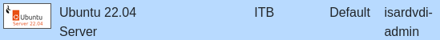
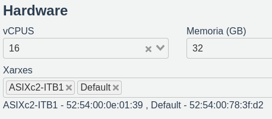
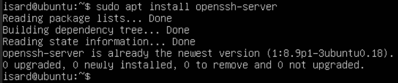
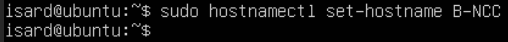
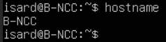

# Base de datos de equipamientos

[Volver al proyecto](../README.md) · [Arquitectura](arquitectura.md) · [Archivos y evidencias](../config/bbdd/README.md)

## 1. Objetivo y alcance de las evidencias

La base de datos proporciona los registros que muestra la aplicación web. El diseño del proyecto sitúa el servidor **B-N02** en la Intranet, con dirección `192.168.20.20/24`, y asigna esta parte a Elias.

La documentación disponible permite describir la preparación de la VM, el trabajo registrado sobre un CSV y la integración visible desde PHP. **No permite reconstruir todavía toda la instalación y carga de MySQL.** La versión anterior de este documento era un historial de terminal, que se conserva íntegro en [historial-original.txt](../config/bbdd/evidencias/historial-original.txt).

| Dato | Fuente y situación |
| --- | --- |
| Nombre previsto | B-N02, según el inventario. |
| Nombre mostrado en las capturas | B-NCC, pendiente de contrastar con la VM actual. |
| Sistema de partida | Plantilla Ubuntu 22.04 Server de Isard. |
| Red prevista | ITB 1, Intranet. |
| Dirección prevista | `192.168.20.20`; coincide con el destino que utiliza PHP. |
| Base indicada en PHP | `equipaments` |
| Tabla mencionada en el historial | `equipaments`; falta mostrar su definición efectiva. |

## 2. Preparación del servidor

El Word muestra la selección de la plantilla y una configuración de preparación con dos conexiones: ITB 1 y Default.



*Figura 1. Plantilla Ubuntu 22.04 Server utilizada en la preparación.*



*Figura 2. Conexiones ITB 1 y Default en la configuración capturada.*

El texto explica que Default se añadió temporalmente para instalar paquetes. El diseño final requiere conservar solo la conexión interna, con salida por R-N02; su retirada no está acreditada con una captura posterior.

Se ejecutó `sudo apt install openssh-server`. La respuesta indica que el paquete ya estaba instalado y actualizado, no que se instalara por primera vez:



*Figura 3. APT informa `openssh-server is already the newest version`.*

El Word describe la preparación del bastión y claves SSH para administrar esta VM, pero no aporta una captura de una sesión remota final identificada en el servidor. La presencia del paquete no demuestra por sí sola que el servicio esté escuchando o sea accesible.

## 3. Nombre provisional observado

La secuencia utiliza:

```bash
sudo hostnamectl set-hostname B-NCC
hostname
```



*Figura 4. El comando visible utiliza B-NCC.*



*Figura 5. La comprobación devuelve B-NCC, distinto del nombre B-N02 del inventario.*

Se conserva la diferencia para que pueda revisarse. No se cambia el comando de la captura por el nombre previsto ni se da por efectuado un renombrado posterior.

## 4. Preparación de los datos registrada en el repositorio

El historial previo contiene estos grupos de operaciones:

| Trabajo registrado | Evidencia y límite |
| --- | --- |
| Descarga del CSV | Uso de `wget -O equipaments.csv` con una URL de Open Data Barcelona. El historial no incluye la salida de descarga. |
| Revisión del archivo | Órdenes `file`, `cat` y `head`; aparece una cabecera con campos como `register_id`, `name` e `institution_name`. |
| Preparación de estructura SQL | Intentos de generar `crear_tabla.sql` a partir de la cabecera, usando columnas `TEXT`. No se conserva el archivo SQL resultante. |
| Revisión de codificación | Intentos con `iconv` y eliminación de bytes nulos. No se muestra la validación final de la codificación. |
| Ejecución del archivo SQL | Órdenes `sudo mysql equipaments < crear_tabla.sql`, sin sus resultados. |
| Preparación de carga | Movimiento del CSV a `/var/lib/mysql-files/` y apertura de la consola MySQL. Falta la sentencia de carga y su salida. |

Se trata de un registro de trabajo, con repeticiones, correcciones y errores de escritura. No se convierte en un script de instalación: contiene comandos incompletos y operaciones sobre archivos que requieren contexto. Su presencia acredita el registro de esos intentos, no el éxito de cada uno.

La carga mediante `LOAD DATA` exige ajustar el formato real del CSV, cabeceras, separadores, delimitación y codificación, además de los permisos y restricciones del servidor. Sin la sentencia ejecutada y su resultado, no se puede afirmar que la importación completa esté verificada. Referencia: [LOAD DATA de MySQL](https://dev.mysql.com/doc/refman/8.0/en/load-data.html).

## 5. Evidencia de integración con la aplicación

El fragmento de `/var/www/html/index.php` en W-N02 contiene:

```php
$host = "192.168.20.20";
$bd = "equipaments";
```

El formulario intenta abrir una conexión `mysqli` con las credenciales introducidas. Después del acceso, la aplicación muestra registros de equipamientos:


*Figura 6. La pantalla muestra `bchecker` y 200 filas, con columnas de identificación, nombre e institución.*

Esto respalda el funcionamiento observado de la aplicación con datos. Para atribuir y reproducir toda la carga hacen falta la configuración efectiva de MySQL, el código de consulta y el estado real del esquema. El número mostrado no se interpreta como el total de filas de la base de datos.

## 6. Comprobaciones pendientes

Para completar esta sección, recoger directamente en la VM:

- [ ] Hostname definitivo, IP efectiva y tabla de rutas.
- [ ] Versión de MySQL y estado del servicio.
- [ ] Configuración de escucha que permite el acceso desde W-N02.
- [ ] Definición real de `equipaments`, incluidos tipos, claves y tabla consultada.
- [ ] Creación del usuario de MySQL y permisos efectivos de acceso desde la aplicación.
- [ ] Archivo SQL o procedimiento de carga utilizado, con resultados y recuento de registros.
- [ ] Consulta de muestra y prueba de conexión desde W-N02.

La cuenta Linux `bchecker`, el usuario de MySQL y el acceso a la aplicación se deben comprobar por separado. Las cuentas de MySQL pueden tener restricciones por origen; no se inventan sentencias `GRANT` ni parámetros de escucha sin conocer la configuración aplicada.
