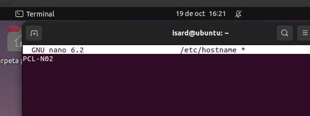
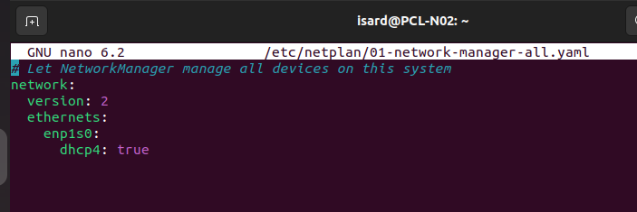
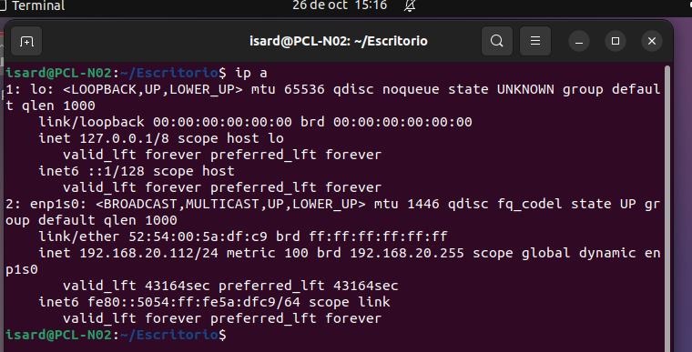
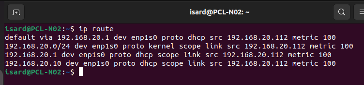
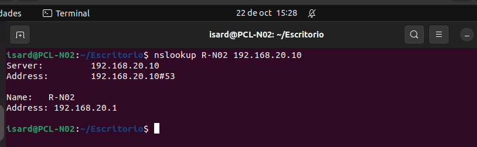
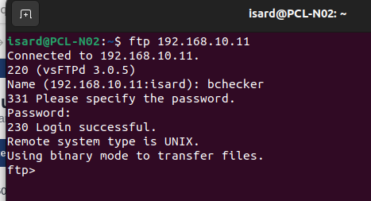
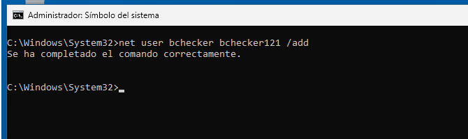
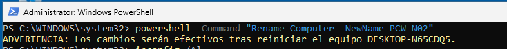
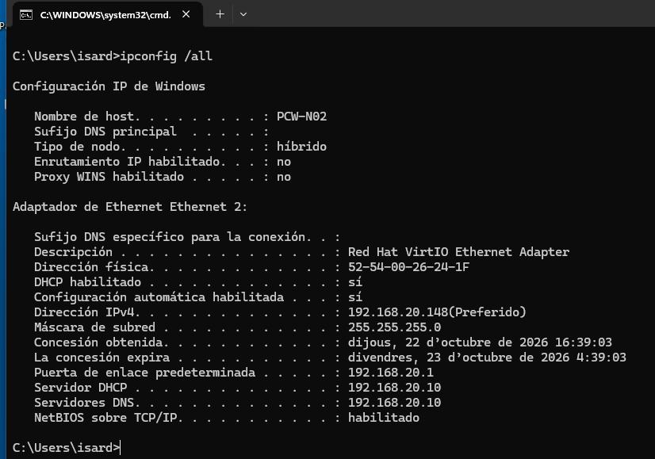

# Clientes PCL-N02 y PCW-N02

[Volver al proyecto](../README.md) · [Arquitectura](arquitectura.md) · [Configuración de clientes](../config/clientes/README.md)

## 1. Objetivo

Los clientes se usan para probar los servicios de la infraestructura: uno es Linux y el otro Windows. Los dos están en la Intranet `192.168.20.0/24` (ITB 1 en Isard), con R-N02 como puerta de enlace y DNS-N02 como servidor DNS y DHCP.

| Equipo | Sistema | IPv4 | Asignación | Puerta de enlace |
| --- | --- | --- | --- | --- |
| PCL-N02 | Ubuntu con entorno gráfico | `192.168.20.112/24` | DHCP | `192.168.20.1` |
| PCW-N02 | Windows | `192.168.20.148/24` | DHCP | `192.168.20.1` |

Las IP son las que aparecen en las capturas y pueden cambiar, ya que las da el DHCP. El rango de DNS-N02 va de `192.168.20.100` a `192.168.20.150`, con concesiones de 12 horas.

## 2. Cliente Linux (PCL-N02)

### 2.1. Nombre del equipo

Para poner el nombre se edita el archivo `/etc/hostname`:

```bash
sudo nano /etc/hostname
```

El contenido queda así:

```text
PCL-N02
```



*Figura 1. Edición del hostname. En las capturas siguientes el prompt ya muestra PCL-N02.*

Con esto el nombre queda guardado, pero para que se aplique en el sistema que ya está encendido hay que reiniciar.

### 2.2. Red por DHCP

La red se configura en `/etc/netplan/01-network-manager-all.yaml`:

```yaml
network:
  version: 2
  ethernets:
    enp1s0:
      dhcp4: true
```

Con `dhcp4: true` el cliente pide su configuración al servidor DHCP. La IP `.112` no se pone a mano, la recibe del servidor. La ruta por defecto y los DNS tampoco se configuraron manualmente.



*Figura 2. Configuración de `enp1s0` con DHCP activado. El comentario del archivo menciona NetworkManager.*

La copia del YAML está en [config/dns-dhcp/netplan-cliente-linux.yaml](../config/dns-dhcp/netplan-cliente-linux.yaml). Si se quiere probar un cambio antes de aplicarlo, se pueden usar `sudo netplan generate` y `sudo netplan try`.

Referencia: [configuración YAML de Netplan](https://netplan.readthedocs.io/en/stable/netplan-yaml/).

### 2.3. Dirección recibida

Se ejecutó:

```bash
ip a
```



*Figura 3. `enp1s0` está activa y tiene `192.168.20.112/24`, marcada como `dynamic`.*

La IP está dentro del rango del proyecto y viene por DHCP, como se ve por la marca `dynamic` y por la ruta con `proto dhcp`.

### 2.4. Tabla de rutas

```bash
ip route
```

La línea principal es:

```text
default via 192.168.20.1 dev enp1s0 proto dhcp src 192.168.20.112 metric 100
```



*Figura 4. La puerta de enlace por defecto es R-N02 y la ruta llegó por DHCP.*

La red `192.168.20.0/24` se alcanza directamente por la interfaz. Para llegar a la DMZ o a otras redes, el cliente sale por `192.168.20.1`.

### 2.5. Resolución de nombres

```bash
nslookup R-N02 192.168.20.10
```

La respuesta es `R-N02` con la dirección `192.168.20.1`:



*Figura 5. DNS-N02 responde bien a la consulta del nombre del router.*

### 2.6. Acceso al FTP de la DMZ

En la parte de FTP aparece una terminal `isard@PCL-N02` ejecutando:

```bash
ftp 192.168.10.11
```



*Figura 6. Inicio de sesión con `bchecker` y respuesta `230 Login successful`.*

Con esto se entra en F-N02 desde la Intranet, pasando por R-N02 hacia la DMZ. El detalle está en [Servidor FTP](<Servidor FTP.md>).

## 3. Cliente Windows (PCW-N02)

### 3.1. Usuario de revisión

Desde una consola con permisos de administrador se creó el usuario local `bchecker`, con la contraseña de laboratorio que está en el [README](../README.md). Windows confirmó que el comando se completó correctamente.



*Figura 7. Ejecución de `net user ... /add` y confirmación de que se creó la cuenta.*

### 3.2. Nombre del equipo

Se ejecutó:

```powershell
powershell -Command "Rename-Computer -NewName PCW-N02"
```



*Figura 8. Windows avisa de que el cambio se aplicará al reiniciar.*

Después de reiniciar, en `ipconfig /all` el nombre del host ya es **PCW-N02**.

Referencia: [Rename-Computer de Microsoft](https://learn.microsoft.com/en-us/powershell/module/microsoft.powershell.management/rename-computer).

### 3.3. Parámetros recibidos por DHCP

```cmd
ipconfig /all
```



*Figura 9. Configuración del adaptador Ethernet 2 de PCW-N02.*

| Parámetro | Valor |
| --- | --- |
| DHCP habilitado | Sí |
| Dirección IPv4 | `192.168.20.148` |
| Máscara | `255.255.255.0` |
| Puerta de enlace | `192.168.20.1` |
| Servidor DHCP | `192.168.20.10` |
| Servidor DNS | `192.168.20.10` |

DNS-N02 actúa como servidor DHCP y DNS, y la IP está dentro del rango configurado.

Referencia: [ipconfig de Microsoft](https://learn.microsoft.com/en-us/windows-server/administration/windows-commands/ipconfig).

## 4. Acceso a la aplicación web

Desde el navegador de un cliente se accede a `http://192.168.10.10/index.php`, donde aparecen el formulario y la tabla de resultados. Las capturas están en la [documentación web](<Servidor web, SSH y aplicación de prueba.md>).
## 5. Pendiente de comprobar

| Revisión | Linux | Windows |
| --- | --- | --- |
| Nombre del equipo | Se ve en el prompt | Se ve en `ipconfig /all` |
| IP por DHCP | Comprobado (dirección dinámica y rutas) | Comprobado (`ipconfig /all`) |
| Sesión FTP | Comprobado con `bchecker` | Falta prueba |

Para cerrar la validación falta identificar cada equipo antes de hacer las capturas, comprobar que llegan al gateway y repetir las pruebas de DNS y de acceso web en los dos. Con la revisión de las tarjetas de Isard se confirmará que solo tienen la conexión interna prevista.
