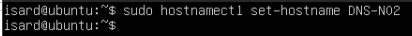
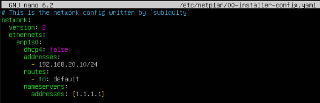
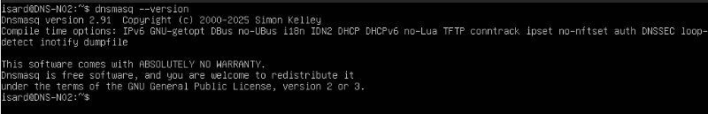
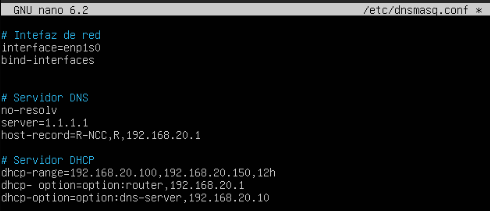
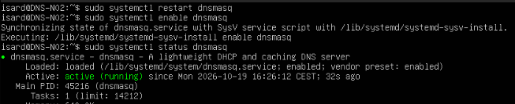
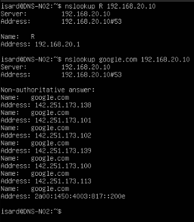
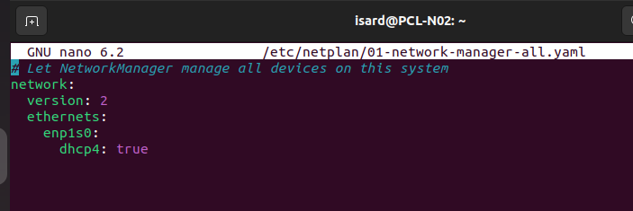
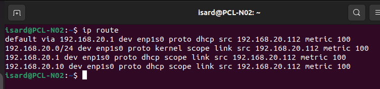
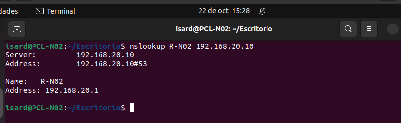
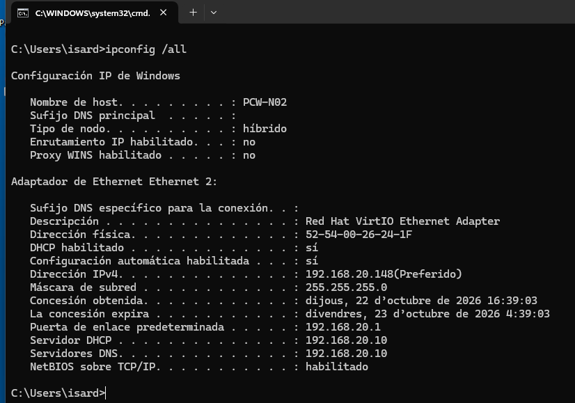

# Servidor DNS y DHCP

[Volver al índice del proyecto](../README.md)

## 1. Objetivo

El servidor **DNS-N02** proporciona los servicios DNS y DHCP a los equipos de la Intranet del proyecto. Ambos servicios se implementan con **dnsmasq** en una misma máquina:

- **DNS:** resuelve nombres internos y reenvía las consultas de nombres externos al servidor `1.1.1.1`.
- **DHCP:** asigna automáticamente una dirección IPv4, la máscara de red, la puerta de enlace y el servidor DNS a los clientes.

Esta documentación recoge la preparación del servidor, su configuración y las pruebas realizadas desde los clientes Linux y Windows. Las capturas proceden del documento de la práctica; las comprobaciones adicionales propuestas se identifican como pendientes de evidencia.

Los archivos de configuración se conservan por separado en [config/dns-dhcp](../config/dns-dhcp/README.md). Aquí se explica qué se ha hecho, por qué se han elegido esos valores y qué resultados muestran las pruebas. El [inventario de configuración](<Ficheros de configuración.md>) relaciona cada archivo con su ubicación en las máquinas.

### 1.1. Fundamento y decisiones de diseño

DNS permite utilizar nombres en lugar de recordar direcciones IP. En este proyecto, dnsmasq responde con los registros locales que conoce y reenvía las consultas externas a `1.1.1.1`. También puede conservar respuestas en caché. La práctica acredita consultas internas y externas; no incorpora una medición de la caché.

DHCP evita configurar manualmente cada cliente. En una asignación inicial habitual se intercambian cuatro mensajes: **DHCPDISCOVER** para buscar un servidor, **DHCPOFFER** para ofrecer una dirección, **DHCPREQUEST** para solicitarla y **DHCPACK** para confirmar la concesión. Esta secuencia es la explicación teórica del protocolo; no se ha aportado una captura del tráfico de esos mensajes.

La concesión dura 12 horas: el cliente debe renovarla para seguir utilizando la dirección. Las IP observadas en las pruebas son asignaciones dinámicas, no reservas permanentes. El rango contiene 51 direcciones y deja fuera las IP fijas del router, del servidor DNS/DHCP y de la base de datos.

Se utiliza dnsmasq porque reúne los dos servicios necesarios en un único programa y archivo de configuración. La IP fija permite localizar el servidor, la puerta de enlace permite alcanzar otras redes y la opción DNS de DHCP hace que los clientes consulten al servidor local. Entregar únicamente un DNS externo no permitiría consultar los nombres internos definidos solo en este servidor.

## 2. Parámetros de red

| Parámetro | Valor |
| --- | --- |
| Nombre del servidor | `DNS-N02` |
| Red de Isard | `ITB 1` (Intranet) |
| Interfaz del servidor | `enp1s0` |
| Subred | `192.168.20.0/24` |
| Máscara | `255.255.255.0` |
| IP fija del servidor | `192.168.20.10` |
| Puerta de enlace | `192.168.20.1` (`R-N02`) |
| DNS externo de reenvío | `1.1.1.1` |
| Rango DHCP | `192.168.20.100` a `192.168.20.150`, ambos incluidos |
| Duración de la concesión | `12h` |
| DNS entregado a los clientes | `192.168.20.10` |

El servidor y los clientes utilizan una única tarjeta conectada a `ITB 1`. La salida a Internet se realiza a través del router del proyecto. La dirección fija del servidor queda fuera del rango DHCP para evitar que se asigne a un cliente.

## 3. Preparación del servidor

### 3.1. Usuario y herramientas

El proyecto requiere el usuario `bchecker`. Si todavía no existe, se crea con:

```bash
sudo adduser bchecker
```

La captura del documento original indica que el usuario ya existía al intentar crearlo de nuevo; por tanto, no debe repetirse su creación.

Se actualiza el índice de paquetes y se instalan el servicio SSH y el editor de texto:

```bash
sudo apt update
sudo apt install openssh-server nano
```

### 3.2. Nombre del equipo

Se asigna el nombre previsto en la arquitectura:

```bash
sudo hostnamectl set-hostname DNS-N02
```



*Figura 1. Cambio del nombre del servidor a DNS-N02.*

### 3.3. Dirección IP fija

El servidor necesita una dirección estable para que los clientes puedan localizarlo. Se comprueban la interfaz y los archivos de Netplan:

```bash
ip a
ls /etc/netplan/
sudo nano /etc/netplan/00-installer-config.yaml
```

La [transcripción de la captura original](../config/dns-dhcp/evidencias/netplan-servidor-captura.yaml.txt) conserva el contenido visible. La [configuración de red completa propuesta](../config/dns-dhcp/netplan-servidor.yaml) añade la puerta de enlace que falta en esa captura. Se conserva como propuesta hasta contrastarla con la máquina.

Se utiliza `1.1.1.1` como DNS del propio servidor durante la preparación. Este ajuste es independiente del DNS `192.168.20.10` que DHCP entrega a los clientes.



*Figura 2. Captura original de Netplan. Muestra la IP de la Intranet, pero la ruta predeterminada aparece incompleta: falta `via: 192.168.20.1`.*

> **Corrección del documento original:** para DNS-N02 corresponden `192.168.20.10/24` y la puerta de enlace `192.168.20.1`. Las direcciones `192.168.10.10` y `192.168.10.1` pertenecen a la DMZ y no deben utilizarse en este servidor. El archivo propuesto completa la ruta omitida en la captura; no acredita que esa corrección ya se haya aplicado en la máquina.

Para validar la sintaxis y aplicar los cambios:

```bash
sudo netplan generate
sudo netplan apply
```

Si se modifica la red por SSH, puede utilizarse `sudo netplan try` para probar los cambios con reversión automática si no se confirman. El nombre de la interfaz y del archivo deben adaptarse si son distintos en la máquina.

## 4. Instalación de DNS y DHCP

Se instalan dnsmasq y las herramientas de consulta DNS:

```bash
sudo apt install dnsmasq dnsutils
dnsmasq --version
```

`dnsmasq` proporciona los dos servicios y `dnsutils` incorpora herramientas como `nslookup` y `dig` para comprobar la resolución de nombres.



*Figura 3. Comprobación de la instalación. La captura muestra dnsmasq 2.91.*

## 5. Configuración de dnsmasq

Los dos servicios se configuran en el mismo archivo:

```bash
sudo nano /etc/dnsmasq.conf
```

Las directivas visibles en la captura se conservan en [config/dns-dhcp/dnsmasq.conf](../config/dns-dhcp/dnsmasq.conf). Es una transcripción de la evidencia aportada, no una descarga del archivo actual de la máquina. La explicación de cada ajuste se recoge a continuación.



*Figura 4. Configuración original de dnsmasq con el rango, la puerta de enlace y el DNS de los clientes.*

| Directiva | Función |
| --- | --- |
| `interface=enp1s0` | Selecciona la interfaz de la Intranet; dnsmasq añade también la interfaz de bucle local. |
| `bind-interfaces` | Vincula la escucha a las interfaces seleccionadas. |
| `no-resolv` | Evita obtener los servidores de reenvío desde `/etc/resolv.conf`. |
| `server=1.1.1.1` | Define el servidor DNS externo de reenvío. |
| `host-record=R-NCC,R,192.168.20.1` | Asocia los nombres internos `R-NCC` y `R` con la IP del router. |
| `dhcp-range=192.168.20.100,192.168.20.150,12h` | Define el intervalo de direcciones y la duración de las concesiones. |
| `dhcp-option=option:router,192.168.20.1` | Entrega la puerta de enlace a los clientes. |
| `dhcp-option=option:dns-server,192.168.20.10` | Entrega el DNS local a los clientes. |

### 5.1. Coherencia del nombre del router

En la arquitectura del repositorio, el router se llama `R-N02`. Sin embargo, la captura inicial de dnsmasq contiene `R-NCC` y `R`. Una prueba posterior desde Linux muestra que `R-N02` también se resuelve, pero no se aporta la configuración que permite esa resolución.

Para incluir expresamente el nombre utilizado en la arquitectura se conserva una [versión propuesta de dnsmasq.conf](../config/dns-dhcp/propuestas/dnsmasq.conf), que incorpora `R-N02` al registro del router.

Así se mantiene la compatibilidad con los nombres de la captura inicial y se añade `R-N02`. Esta es una **corrección propuesta**: antes de darla por aplicada debe comprobarse la configuración real, validarla y repetir la consulta DNS.

## 6. Inicio y comprobación del servicio

Tras guardar la configuración, en la práctica se reinicia dnsmasq, se habilita su inicio automático y se consulta su estado:

```bash
sudo systemctl restart dnsmasq
sudo systemctl enable dnsmasq
sudo systemctl status dnsmasq
```



*Figura 5. dnsmasq aparece habilitado y en estado `active (running)`.*

Como comprobación adicional, conviene ejecutar lo siguiente **antes de reiniciar** cada vez que se edite el archivo:

```bash
sudo dnsmasq --test
```

Esta orden valida la sintaxis sin iniciar el servicio. No se dispone de una captura de su ejecución en la práctica.

## 7. Pruebas de resolución DNS

### 7.1. Nombre interno y nombre externo desde el servidor

Se consulta directamente al DNS local:

```bash
nslookup R 192.168.20.10
nslookup google.com 192.168.20.10
```

La primera consulta devuelve `192.168.20.1`, la dirección del router en la Intranet. La segunda obtiene direcciones de `google.com`, lo que acredita la resolución de un nombre externo a través de dnsmasq. Las direcciones devueltas para un dominio público pueden cambiar entre consultas.



*Figura 6. Resolución correcta de un nombre interno y de un dominio externo.*

## 8. Validación desde los clientes

Las pruebas de los clientes se incluyen aquí porque permiten verificar los servicios DNS y DHCP desde otros equipos de la Intranet.

### 8.1. Cliente Linux: PCL-N02

El cliente se conecta a `ITB 1` y se activa DHCP para IPv4. En la práctica se edita `/etc/netplan/01-network-manager-all.yaml`. Su contenido visible se conserva en [config/dns-dhcp/netplan-cliente-linux.yaml](../config/dns-dhcp/netplan-cliente-linux.yaml); el ajuste `dhcp4: true` solicita los parámetros de red automáticamente.

Después de guardar el archivo se aplica la configuración:

```bash
sudo netplan generate
sudo netplan apply
```



*Figura 7. Configuración del cliente para obtener una dirección IPv4 automáticamente.*

La comprobación aportada se realiza con:

```bash
ip route
```



*Figura 8. La ruta predeterminada utiliza `192.168.20.1`, el origen es `192.168.20.112` y aparece `proto dhcp`.*

La dirección `192.168.20.112` pertenece al rango configurado. La tabla de rutas respalda la obtención de parámetros por DHCP. El documento original menciona una comprobación con `ip a`, pero la imagen situada junto a ese texto repite Netplan; por eso se utiliza la captura de `ip route` como evidencia disponible.

También se comprueba el nombre del router desde el cliente:

```bash
nslookup R-N02 192.168.20.10
```



*Figura 9. El DNS local responde a la consulta de `R-N02` con `192.168.20.1`.*

Esta orden verifica una consulta dirigida expresamente al servidor `192.168.20.10`. Por sí sola no demuestra qué DNS utiliza Linux cuando no se especifica un servidor.

### 8.2. Cliente Windows: PCW-N02

En el cliente Windows se consulta la configuración de red con:

```bat
ipconfig /all
```



*Figura 10. Configuración recibida por el cliente Windows.*

La captura muestra:

| Parámetro | Resultado observado |
| --- | --- |
| Nombre del equipo | `PCW-N02` |
| DHCP habilitado | Sí |
| Dirección IPv4 | `192.168.20.148` |
| Máscara | `255.255.255.0` |
| Puerta de enlace | `192.168.20.1` |
| Servidor DHCP | `192.168.20.10` |
| Servidor DNS | `192.168.20.10` |
| Concesión | Se muestran las fechas de obtención y caducidad, separadas por 12 horas. |

La dirección asignada pertenece al rango previsto y tanto el DNS como la puerta de enlace coinciden con la configuración de dnsmasq. Esta captura verifica los parámetros recibidos; no incluye una consulta DNS ejecutada desde Windows.

## 9. Resultados y evidencias pendientes

| Comprobación | Evidencia disponible | Resultado |
| --- | --- | --- |
| Instalación de dnsmasq | Figura 3 | Versión 2.91. |
| Servicio en ejecución e inicio automático habilitado | Figura 5 | `active (running)` y `enabled`. |
| Resolución del nombre interno `R` | Figura 6 | Devuelve `192.168.20.1`. |
| Resolución de un dominio externo | Figura 6 | `google.com` devuelve direcciones IP. |
| Parámetros DHCP en Linux | Figura 8 | IP `192.168.20.112` y puerta de enlace `192.168.20.1`. |
| Consulta DNS desde Linux | Figura 9 | `R-N02` devuelve `192.168.20.1`. |
| Parámetros DHCP y DNS en Windows | Figura 10 | IP `192.168.20.148`, DNS y DHCP `192.168.20.10`. |

Las capturas respaldan el funcionamiento de ambos servicios en las pruebas descritas. Para completar la trazabilidad de la configuración faltaría:

1. Aportar una captura final de Netplan con la ruta completa y su validación.
2. Aportar la configuración final que permite resolver `R-N02` y la salida de `sudo dnsmasq --test`.
3. Mostrar el DNS recibido por Linux, por ejemplo con `resolvectl status` si utiliza systemd-resolved, y realizar una consulta sin indicar el servidor.
4. Ejecutar `nslookup R-N02` y `nslookup google.com` desde Windows para verificar la resolución con su DNS configurado.
5. Si se quiere acreditar la persistencia, repetir las comprobaciones después de reiniciar el servidor. La habilitación del servicio está documentada; no se aporta una prueba posterior al reinicio.

Estos puntos son verificaciones adicionales propuestas, no resultados ya obtenidos.

## 10. Referencias

- Documento de la práctica **Explicación i Capturas-2.pdf**: páginas 3 a 6 para el servidor y páginas 8 a 10 para las pruebas de los clientes. Las imágenes se han extraído del PDF sin modificar su contenido.
- [Arquitectura e inventario del proyecto](../README.md).
- [Manual oficial de dnsmasq](https://thekelleys.org.uk/dnsmasq/docs/dnsmasq-man.html): significado de las directivas y comprobación de sintaxis.
- [Documentación de Netplan](https://netplan.readthedocs.io/en/stable/examples/) y [órdenes de Netplan](https://netplan.io/): direcciones estáticas, DHCP y aplicación de cambios.
- [RFC 2131, sección 3.1](https://www.rfc-editor.org/rfc/rfc2131.html#section-3.1): intercambio de mensajes y concesión de direcciones mediante DHCP.
