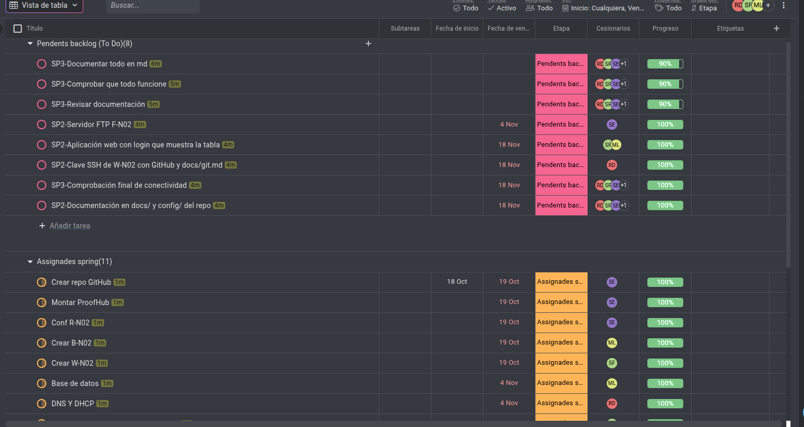
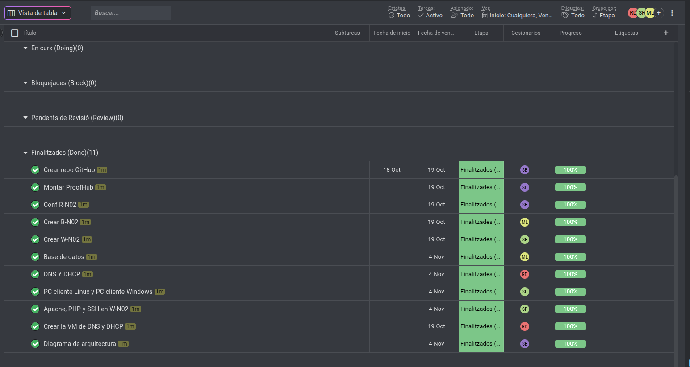
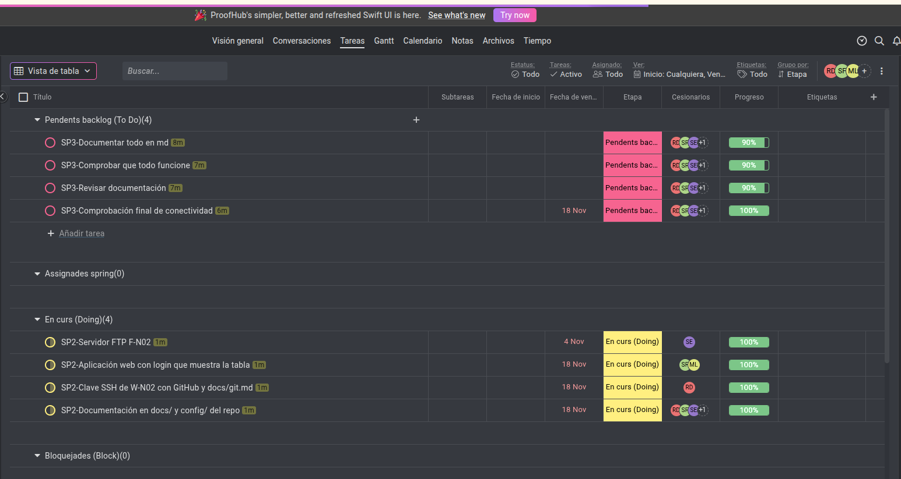
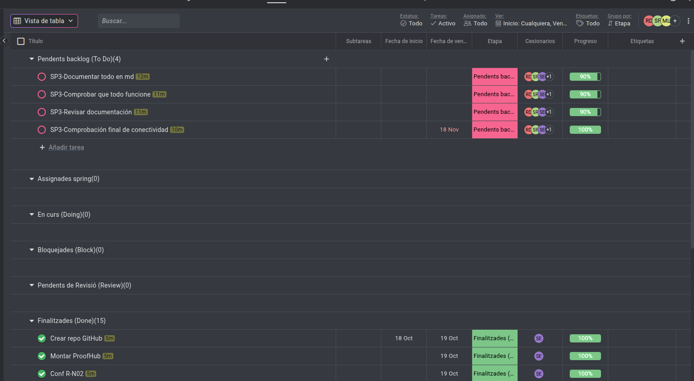
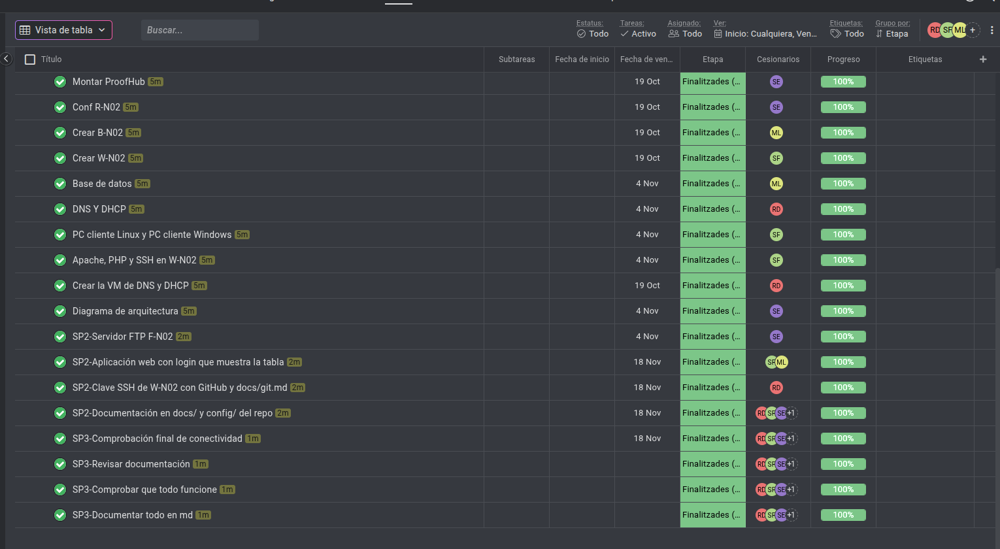

# Planificación y seguimiento del proyecto con ProofHub

[Volver al proyecto](../README.md) · [Arquitectura](arquitectura.md) · [Manual de usuario y administración](<Manual de usuario y administracion.md>)

## 1. Cómo organizamos el trabajo

Utilizamos ProofHub para repartir el trabajo de la infraestructura N02, seguir las tareas y comprobar qué quedaba pendiente. En el tablero se agruparon actividades relacionadas con el router, las máquinas virtuales, DNS y DHCP, la base de datos, el servidor web, el FTP, los equipos cliente y la documentación.

El proyecto se dividió en tres sprints. Primero se preparó la infraestructura base con sus servicios de red. Después se añadieron el FTP, la aplicación web y la conexión con GitHub. Al final se hicieron las comprobaciones y se cerró la documentación. En el tablero, las tareas del Sprint 2 llevan el prefijo `SP2-` y las del Sprint 3 el prefijo `SP3-`. Las del Sprint 1 no llevan prefijo.

De cada sprint guardamos dos capturas del tablero en vista de tabla, agrupado por etapa. La primera muestra el estado al comienzo del sprint y la segunda, cómo quedaron las tareas al final. Así se ve cómo pasa el trabajo de una etapa a otra.

Cada tarea del tablero tiene un título, una fecha de vencimiento, una etapa, uno o varios responsables y un porcentaje de progreso. La única tarea con fecha de inicio es la creación del repositorio (18 de octubre). Las demás fechas que aparecen son de vencimiento. Los responsables se ven con las iniciales del tablero (RD, SF, SE y ML). Cuando una tarea es de todo el grupo, ProofHub muestra tres avatares y «+1».

| Sprint | Objetivo | Tareas | Vencimientos |
|---|---|---|---|
| Sprint 1. Infraestructura base | Organizar el equipo, crear las máquinas virtuales y configurar el router y los servicios de red. | 11 | 19 de octubre y 4 de noviembre |
| Sprint 2. Servicios y aplicación web | Montar el FTP, la aplicación web con login, la conexión de W-N02 con GitHub y la documentación del repositorio. | 4 | 4 y 18 de noviembre |
| Sprint 3. Comprobación y entrega | Comprobar la conectividad y el funcionamiento, y revisar y terminar la documentación. | 4 | 18 de noviembre (solo la comprobación de conectividad) |

### Etapas del tablero

| Etapa | Uso |
|---|---|
| Pendents backlog (To Do) | Tareas registradas que todavía no pertenecen al sprint en curso. |
| Assignades spring | Tareas asignadas al sprint que empieza. En el tablero aparece escrito así, *spring* en lugar de *sprint*. |
| En curs (Doing) | Tareas en las que se está trabajando. |
| Bloquejades (Block) | Tareas detenidas por algún problema. |
| Pendents de Revisió (Review) | Tareas terminadas que falta revisar. |
| Finalitzades (Done) | Tareas terminadas. |

### Equipo y reparto de tareas

Este es el reparto inicial recogido en el README. Sirve de referencia para entender los responsables, pero no significa que una tarea concreta se completara exclusivamente por una persona.

| Integrante | Responsabilidad inicial |
|---|---|
| Elian | Router, planificación con ProofHub y diagrama de arquitectura. |
| Daniel | Repositorio GitHub y servicios DNS/DHCP. |
| Faiver | Servidor web, SSH, clientes y aplicación PHP. |
| Elias | Base de datos y servidor FTP. |

## 2. Sprint 1 — Infraestructura base

**Objetivo.** Preparar las herramientas de trabajo del equipo, montar las tres redes con sus máquinas virtuales y dejar funcionando el router y los servicios básicos sobre los que se apoyan los sprints siguientes.

### 2.1. Comienzo del sprint

*Figura 1. Comienzo del Sprint 1: las 11 tareas del sprint están en Assignades spring y las 8 tareas de los sprints 2 y 3 (SP2 y SP3) esperan en Pendents backlog (To Do).*

### 2.2. Qué hicimos en el sprint

El sprint tuvo dos partes. En la primera, con vencimiento el 19 de octubre, creamos el repositorio y el tablero de ProofHub, configuramos el router y creamos las máquinas virtuales. En la segunda, con vencimiento el 4 de noviembre, configuramos los servicios en esas máquinas, preparamos los clientes y elaboramos el diagrama de arquitectura.

- Definimos los roles del equipo, registramos las tareas en ProofHub y creamos el repositorio, con la documentación, la configuración y las capturas en carpetas separadas.
- Diseñamos las tres redes de Isard: Default (exterior), ITB 2 (DMZ, 192.168.10.0/24) e ITB 1 (Intranet, 192.168.20.0/24).
- Configuramos el router R-N02 con tres interfaces, reenvío IPv4 y NAT para la salida a Internet.
- Creamos las máquinas virtuales W-N02, B-N02 y DNS-N02 con los nombres e IPs del esquema.
- Configuramos DNS-N02 (192.168.20.10) con dnsmasq para DNS y DHCP, que entrega el rango 192.168.20.100-150.
- Instalamos Apache, PHP y el conector MySQL en W-N02 (192.168.10.10), además del acceso por SSH.
- Preparamos la base de datos de equipamientos en B-N02 (192.168.20.20, según el diseño) a partir del CSV trabajado por el equipo.
- Preparamos los clientes PCL-N02 y PCW-N02, que reciben la red por DHCP desde DNS-N02.
- Hicimos el diagrama de arquitectura con las tres redes y las máquinas de cada una.

| Tarea en ProofHub | Responsable | Vencimiento |
|---|---|---|
| Crear repo GitHub | SE | 19 oct (inicio 18 oct) |
| Montar ProofHub | SE | 19 oct |
| Conf R-N02 | SE | 19 oct |
| Crear B-N02 | ML | 19 oct |
| Crear W-N02 | SF | 19 oct |
| Crear la VM de DNS y DHCP | RD | 19 oct |
| Base de datos | ML | 4 nov |
| DNS Y DHCP | RD | 4 nov |
| PC cliente Linux y PC cliente Windows | SF | 4 nov |
| Apache, PHP y SSH en W-N02 | SF | 4 nov |
| Diagrama de arquitectura | SE | 4 nov |

Evidencias técnicas relacionadas: [Arquitectura](arquitectura.md), [Router R-N02](router.md), [DNS y DHCP](<DNS y DHCP.md>), [Clientes](Clientes.md) y [Servidor web, SSH y aplicación de prueba](<Servidor web, SSH y aplicación de prueba.md>). Las capturas del router muestran la configuración de IP, `ip_forward=1`, la regla NAT y pruebas desde la DMZ hacia el gateway y una IP exterior.

### 2.3. Final del sprint

*Figura 2. Final del Sprint 1: las 11 tareas están en Finalitzades (Done) al 100% y las etapas En curs, Bloquejades y Pendents de Revisió están vacías.*

**Cierre del sprint.** La documentación técnica acredita que el router se configuró y que desde W-N02 se llegó tanto a la puerta de enlace 192.168.10.1 como a 8.8.8.8. Eso no demuestra por sí mismo que todas las reglas de seguridad entre la DMZ y la Intranet estén cerradas; esa revisión sigue pendiente.

## 3. Sprint 2 — Servicios y aplicación web

**Objetivo.** Completar los servicios que faltaban sobre la infraestructura del Sprint 1: el servidor FTP, la aplicación web conectada a la base de datos y la conexión de W-N02 con GitHub, y empezar a documentarlo en el repositorio.

### 3.1. Comienzo del sprint

*Figura 3. Comienzo del Sprint 2: las 4 tareas SP2 están en En curs (Doing), Assignades spring está vacía y las 4 tareas SP3 siguen en Pendents backlog (To Do).*

### 3.2. Qué hicimos en el sprint

- Instalamos y configuramos vsftpd en F-N02 (192.168.10.11), en la DMZ, para permitir el acceso a usuarios locales.
- Desarrollamos la aplicación web en PHP, alojada en W-N02, con una página de inicio de sesión que, después del login, muestra la tabla de equipamientos guardada en la base de datos.
- Generamos una clave SSH en W-N02 para conectar con el repositorio de GitHub y documentamos el proceso en [Control de versiones con Git](<Control de versiones con Git.md>).
- Entre todo el grupo documentamos cada parte en Markdown dentro de `docs/` y guardamos los archivos de configuración en `config/`, sin presentar fragmentos como si fueran instalaciones completas.

| Tarea en ProofHub | Responsable | Vencimiento |
|---|---|---|
| SP2-Servidor FTP F-N02 | SE | 4 nov |
| SP2-Aplicación web con login que muestra la tabla | SF y ML | 18 nov |
| SP2-Clave SSH de W-N02 con GitHub y docs/git.md | RD | 18 nov |
| SP2-Documentación en docs/ y config/ del repo | Todo el grupo | 18 nov |

Evidencias técnicas relacionadas: [Servidor FTP](<Servidor FTP.md>), [Servidor web, SSH y aplicación de prueba](<Servidor web, SSH y aplicación de prueba.md>), [Base de datos](<Base de datos.md>) y [Control de versiones con Git](<Control de versiones con Git.md>).

### 3.3. Final del sprint

*Figura 4. Final del Sprint 2: Finalitzades (Done) pasa a tener 15 tareas (las 11 del Sprint 1 y las 4 SP2), todas al 100%, y Pendents de Revisió queda vacía.*

**Resultado contrastado con el repositorio.** Hay capturas de vsftpd activo y del formulario y la tabla de la aplicación. En el caso de la base de datos, el historial conserva intentos de preparación del CSV y la aplicación muestra registros en el navegador, pero todavía no se conserva un volcado SQL ni la configuración MySQL completa.

## 4. Sprint 3 — Comprobación y entrega

**Objetivo.** Confirmar que los componentes se comunican entre sí y cerrar la entrega con una documentación útil para quien tenga que usar o administrar el sistema.

### 4.1. Comienzo del sprint

*Figura 5. Comienzo del Sprint 3: las 4 tareas SP3 están en Pendents backlog (To Do), las etapas intermedias están vacías y Finalitzades (Done) tiene las 15 tareas de los sprints 1 y 2.*

### 4.2. Qué hicimos en el sprint

Las cuatro tareas del sprint eran de todo el grupo.

- Probamos la comunicación entre la DMZ, la Intranet y la salida a Internet a través de R-N02, así como las rutas de los clientes.
- Probamos la resolución de nombres internos y externos y que los clientes reciben su IP por DHCP.
- Comprobamos el acceso al FTP desde PCL-N02.
- Abrimos la aplicación desde un navegador, iniciamos sesión y comprobamos que se muestra el listado de equipamientos procedente de MySQL.
- Revisamos el repositorio, relacionamos cada captura con su explicación y preparamos el manual de uso, operación, copias y recuperación.

| Tarea en ProofHub | Vencimiento |
|---|---|
| SP3-Comprobación final de conectividad | 18 nov |
| SP3-Comprobar que todo funcione | Sin fecha |
| SP3-Revisar documentación | Sin fecha |
| SP3-Documentar todo en md | Sin fecha |

Evidencias técnicas relacionadas: [Clientes](Clientes.md), [Servidor web, SSH y aplicación de prueba](<Servidor web, SSH y aplicación de prueba.md>), [Servidor FTP](<Servidor FTP.md>) y [Manual de usuario y administración](<Manual de usuario y administracion.md>).

### 4.3. Final del sprint

*Figura 6. Final del Sprint 3: las tareas de los tres sprints están en Finalitzades (Done) al 100%.*

**Resultados que sí podemos explicar con las pruebas guardadas:**

| Comprobación | Evidencia en el repositorio | Estado documental |
|---|---|---|
| Salida a Internet desde la DMZ | Ping desde W-N02 al router y a 8.8.8.8. | Comprobado en captura. |
| DNS y DHCP | Consultas nslookup, estado de dnsmasq e IPs recibidas por los clientes. | Comprobado en capturas. |
| Servidor web y PHP | Apache activo, formulario y tabla visible tras el inicio de sesión. | Comprobado en capturas. |
| Acceso al FTP | Respuesta 230 Login successful desde PCL-N02. | Comprobado el login, no una transferencia completa. |
| Importación reproducible de MySQL | Historial de trabajo y resultado visible desde PHP. | Pendiente: esquema, carga y permisos efectivos. |
| Acceso SSH a W-N02 | Servicio previsto en el alcance. | Pendiente de prueba remota final. |
| Copia y restauración | Procedimiento propuesto en el manual. | Pendiente de implementación y ensayo. |

## 5. Resumen de los sprints

| Sprint | Tareas | Al comienzo | Al final |
|---|---|---|---|
| Sprint 1 | 11 | En Assignades spring; las 8 de SP2 y SP3 en el backlog. | Las 11 en Finalitzades (Done). |
| Sprint 2 | 4 | En En curs (Doing). | 15 tareas en Finalitzades (11 del Sprint 1 y 4 del Sprint 2). |
| Sprint 3 | 4 | En Pendents backlog (To Do). | Las 19 tareas en Finalitzades (Done). |

## 6. Cómo leer las capturas y qué queda por revisar

Las capturas de ProofHub muestran cómo usamos el tablero para repartir el trabajo y seguir su avance. No sustituyen las evidencias técnicas de cada máquina: para considerar una tarea realizada también hay que poder enseñar el comando, el estado del servicio, la configuración o una prueba desde un cliente.

Por eso, que todas las tareas estén en Finalitzades (Done) indica que el equipo dio por cerrado su trabajo en el tablero, no que todas las pruebas estén hechas. La tabla del apartado 4.3 separa lo que está comprobado en capturas de lo que todavía necesita una prueba adicional.

Antes de cerrar el proyecto conviene revisar en el tablero que cada tarea tenga un responsable, una descripción concreta, su estado actualizado y un enlace a su evidencia técnica. Si una tarea está terminada en ProofHub pero su prueba todavía no está en GitHub, hay que adjuntarla o indicar que la validación sigue pendiente. También conviene corregir el nombre de la columna Assignades spring por Assignades a l'sprint (o Asignadas al sprint).

## 7. Conclusión

ProofHub nos ha servido para organizar el trabajo del equipo y seguir una infraestructura con varios servidores y dependencias. La división en tres sprints refleja cómo avanzó el proyecto: primero la infraestructura base y los servicios de red, después el FTP, la aplicación web y el repositorio, y al final las comprobaciones y la documentación. El repositorio separa lo que se ve comprobado en las capturas de las partes que todavía necesitan una prueba adicional para dar la entrega por completamente validada.
