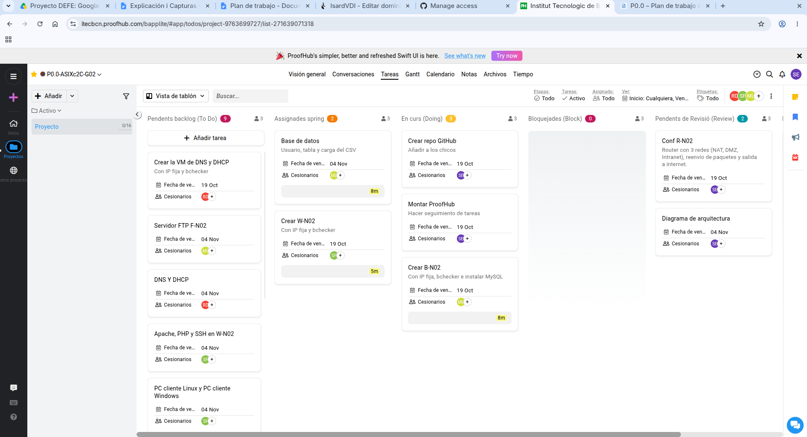
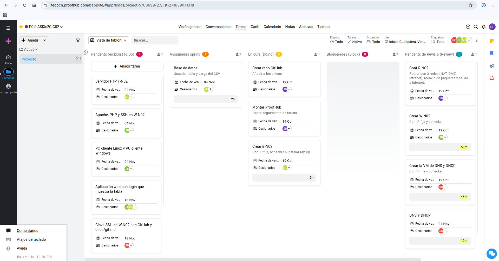

# Planificación y seguimiento con ProofHub

[Volver al proyecto](../README.md) · [Arquitectura y estado de validación](arquitectura.md)

## 1. Uso de ProofHub

En el documento Word hay dos capturas del tablero de ProofHub que hemos utilizado para organizar el proyecto. En ellas se pueden ver las tareas repartidas entre los miembros del grupo, las fechas previstas y el estado de cada tarea.

Las siguientes capturas muestran cómo estaba organizado el tablero cuando se hicieron.

## 2. Organización de las tareas

En el tablero las tareas están separadas según su estado: pendientes, asignadas, en curso, bloqueadas y pendientes de revisión.

Entre las tareas que aparecen están las siguientes:

- Configuración de R-N02 y diagrama de arquitectura.
- Preparación de las máquinas virtuales y los servicios DNS y DHCP.
- Configuración de W-N02 con Apache, PHP y SSH.
- Preparación de la base de datos y carga del CSV.
- Configuración del servidor FTP F-N02.
- Configuración de los clientes Linux y Windows.
- Desarrollo de la aplicación web con inicio de sesión y listado de datos.
- Conexión SSH de W-N02 con GitHub y documentación en Markdown.

*Figura 1. Primera captura del tablero, donde se ven las tareas, sus responsables, las fechas y su estado. El diagrama de arquitectura aparece pendiente de revisión.*

*Figura 2. Segunda captura del tablero con las tareas relacionadas con la infraestructura, los clientes y la aplicación web.*

## 3. Relación con la entrega técnica

Las tareas que aparecen pendientes de revisión todavía tienen que comprobarse antes de darlas por terminadas. Además, las capturas más recientes del documento Word pueden mostrar avances que aún no aparecen reflejados en ProofHub.

Por eso, para saber qué partes de la práctica funcionan, también he tenido en cuenta las pruebas realizadas. Por ejemplo, el inicio de sesión en el servidor FTP, el funcionamiento de la aplicación web y la configuración DHCP de los clientes.

No doy una tarea por terminada únicamente porque aparezca en una columna del tablero. También hay que comprobar que la configuración funciona y que las pruebas se han realizado correctamente.
