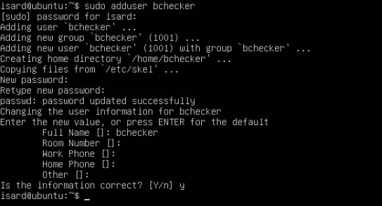
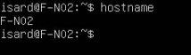
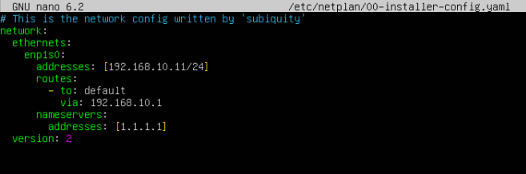
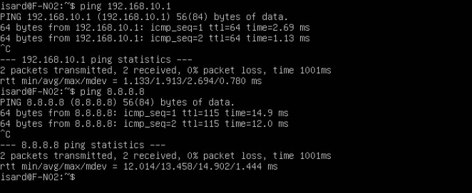
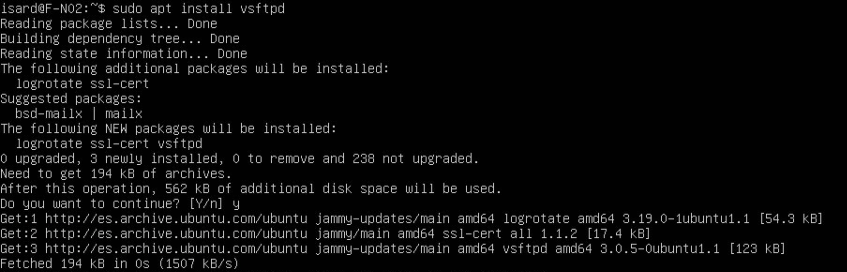
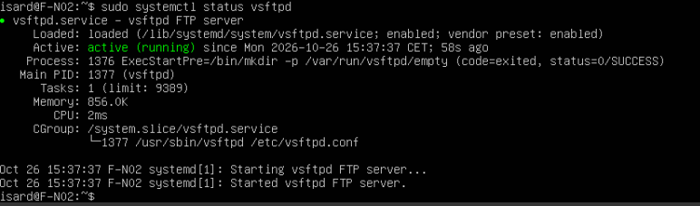
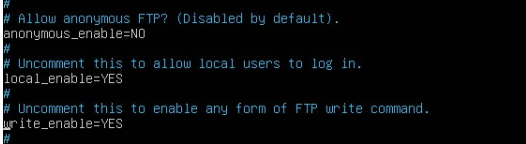

# Servidor FTP F-N02

[Volver al proyecto](../README.md) · [Arquitectura](arquitectura.md) · [Archivos de configuración](../config/ftp/README.md)

## 1. Objetivo y entorno

En esta parte de la práctica he configurado el servidor FTP F-N02 utilizando **vsftpd**. Este servidor está en la DMZ, junto al servidor web, y permite transferir archivos entre los equipos de la red. Para comunicarse con otras redes utiliza el router R-N02.

| Parámetro | Valor |
| --- | --- |
| Hostname | `F-N02` |
| Red de Isard | ITB 2 |
| Segmento | `192.168.10.0/24` |
| Interfaz del servidor | `enp1s0` |
| Dirección IP | `192.168.10.11/24` |
| Puerta de enlace | `192.168.10.1` |
| DNS | `1.1.1.1` |
| Versión de vsftpd | `3.0.5` |

Para instalar el servicio se utilizaron los paquetes del repositorio de Ubuntu Jammy, que corresponde a Ubuntu 22.04. La versión exacta del sistema instalado en la máquina se puede comprobar con el archivo `/etc/os-release`.

En el reparto inicial de la práctica, el servidor FTP estaba asignado a Elias. Las capturas más recientes aparecen en la sección de Elian del documento Word, pero en esta documentación mantengo el reparto que aparece en el repositorio.

## 2. Preparación de la máquina

### 2.1. Usuario y nombre del servidor

Primero creé el usuario `bchecker`, que utilizaré para probar el acceso al servidor FTP.

```bash
sudo adduser bchecker
```



*Figura 1. Creación del usuario local y configuración de su contraseña.*

Después comprobé el nombre de la máquina con este comando:

```bash
hostname
```



*Figura 2. Comprobación del nombre del servidor, que aparece como F-N02.*

En la captura se ve que el nombre del equipo es `F-N02`. Para configurar este nombre desde cero también se puede utilizar el siguiente comando:

```bash
sudo hostnamectl set-hostname F-N02
```

### 2.2. Configuración de la red

Después revisé el archivo de Netplan `/etc/netplan/00-installer-config.yaml`, donde está configurada la dirección IP del servidor.

El contenido que aparece en la captura también está guardado en [netplan-ftp.yaml](../config/ftp/netplan-ftp.yaml).

```yaml
network:
  version: 2
  ethernets:
    enp1s0:
      addresses: [192.168.10.11/24]
      routes:
        - to: default
          via: 192.168.10.1
      nameservers:
        addresses: [1.1.1.1]
```



*Figura 3. Configuración de la IP fija, la puerta de enlace y el servidor DNS.*

La dirección `192.168.10.11/24` es fija, así que los clientes pueden encontrar el servidor FTP siempre en la misma IP. La puerta de enlace es `192.168.10.1`, que corresponde al router R-N02.

En esta configuración aparece `1.1.1.1` como servidor DNS.

### 2.3. Comprobar la conexión de red

Antes de instalar y probar el servicio FTP, comprobé si el servidor podía comunicarse con el router y con una dirección externa.

```bash
ping 192.168.10.1
ping 8.8.8.8
```



*Figura 4. Pruebas de conexión con el router y con una dirección externa.*

En las dos pruebas se enviaron y recibieron dos paquetes, sin pérdidas.

Esto indica que el servidor puede comunicarse con el router y llegar a una dirección externa. Como las pruebas se hicieron con direcciones IP, no se comprueba la resolución de nombres DNS.

## 3. Instalación del servicio FTP

Para instalar el servidor FTP utilicé el siguiente comando:

```bash
sudo apt install vsftpd
```



*Figura 5. Instalación de vsftpd y los paquetes necesarios.*

Una vez instalado, comprobé si el servicio estaba funcionando:

```bash
sudo systemctl status vsftpd
```



*Figura 6. El servicio aparece como `active (running)` y tiene el inicio automático habilitado.*

En la captura se ve que vsftpd está funcionando y que está configurado para iniciarse automáticamente al arrancar el sistema.

Esta comprobación corresponde al momento de la captura. No se muestra una prueba del servicio después de reiniciar la máquina.

## 4. Configuración del acceso y los permisos de escritura

Después revisé el archivo `/etc/vsftpd.conf`, donde aparecen estas opciones:

```ini
anonymous_enable=NO
local_enable=YES
write_enable=YES
```



*Figura 7. Configuración del acceso anónimo, los usuarios locales y la escritura de archivos.*

Estas opciones sirven para configurar cómo se pueden conectar los usuarios al servidor FTP.

| Directiva | Función |
| --- | --- |
| `anonymous_enable=NO` | Desactiva el acceso anónimo al servidor. |
| `local_enable=YES` | Permite que los usuarios locales, como `bchecker`, puedan iniciar sesión, siempre que cumplan el resto de condiciones. |
| `write_enable=YES` | Permite utilizar comandos de escritura, aunque también hacen falta los permisos adecuados en las carpetas. |

He guardado estas opciones en el archivo [vsftpd-fragmento.conf](../config/ftp/vsftpd-fragmento.conf).

Este archivo solo contiene una parte de la configuración del servidor. No incluye todas las opciones relacionadas con las carpetas de los usuarios, el cifrado o los puertos utilizados para transferir archivos.

Después de modificar el archivo de configuración, se puede reiniciar el servicio y comprobar su estado con estos comandos:

```bash
sudo systemctl restart vsftpd
sudo systemctl status vsftpd
```

Referencia: [Manual de configuración de vsftpd para Ubuntu Jammy](https://manpages.ubuntu.com/manpages/jammy/man5/vsftpd.conf.5.html).

## 5. Prueba de acceso desde Linux

Para comprobar que el servidor FTP funcionaba, hice una prueba desde el cliente Linux PCL-N02.

Ejecuté el siguiente comando:

```bash
ftp 192.168.10.11
```

Después introduje el usuario `bchecker` y la contraseña de la práctica. El servidor respondió con estos mensajes:

```text
220 (vsFTPd 3.0.5)
230 Login successful.
```


*Figura 8. Inicio de sesión correcto en el servidor FTP desde PCL-N02.*

En la captura aparece el mensaje `230 Login successful`, lo que confirma que he podido iniciar sesión con el usuario `bchecker`.

Como PCL-N02 está en la Intranet y F-N02 está en la DMZ, la conexión pasa por el router R-N02 para llegar al servidor.

Esta prueba confirma que la conexión y el inicio de sesión funcionan, pero **no demuestra que se puedan subir o descargar archivos**. Para comprobarlo tendría que ejecutar comandos como `ls`, `put` o `get` y verificar el resultado.

Referencia: [Protocolo FTP, RFC 959](https://www.rfc-editor.org/rfc/rfc959).

## 6. Comprobaciones pendientes

Después de revisar las capturas, este es el estado de las pruebas del servidor FTP.

| Comprobación | Estado |
| --- | --- |
| Nombre del servidor F-N02 | Comprobado. |
| IP, puerta de enlace y DNS en Netplan | Aparecen en el archivo de configuración; falta comprobar la configuración aplicada y la tabla de rutas. |
| Conexión con el router y una IP externa | Comprobada mediante ping. |
| Instalación y estado de vsftpd | Comprobados. |
| Inicio de sesión desde PCL-N02 | Correcto con el usuario `bchecker`. |
| Listado de archivos | Pendiente de comprobar. |
| Subida y descarga de archivos | Pendiente de comprobar. |
| Acceso desde Windows | Pendiente de probar. |
| Configuración completa y funcionamiento tras reiniciar | Pendiente de comprobar. |

Para terminar la práctica, me falta probar la transferencia de archivos. Para ello puedo crear un archivo de texto en el cliente, subirlo al servidor con `put` y descargarlo después con `get` utilizando otro nombre.

También tengo que comprobar los permisos de la carpeta donde se guardan los archivos y verificar que la transferencia se realiza correctamente. Estas pruebas todavía están pendientes.
