# Servidor web W-N02 y aplicación de prueba

[Volver al proyecto](../README.md) · [Arquitectura](arquitectura.md) · [Archivos y procedencia](../config/web/README.md)

## 1. Objetivo

W-N02 aloja una aplicación PHP servida con Apache. El formulario pide usuario y contraseña para acceder a un listado de equipamientos de educación, y la aplicación se conecta al servidor de base de datos de la Intranet. El responsable en el repositorio es Faiver.

| Parámetro | Valor |
| --- | --- |
| Hostname | `W-N02` |
| Red | DMZ (ITB 2) |
| Interfaz | `enp1s0` |
| IPv4 | `192.168.10.10/24` |
| Puerta de enlace | `192.168.10.1` |
| DNS | `1.1.1.1` |
| Paquetes instalados | `apache2`, `php`, `php-mysql` |
| Archivo de la aplicación | `/var/www/html/index.php` |
| Servidor MySQL (en el PHP) | `192.168.20.20` |
| Base de datos (en el PHP) | `equipaments` |

## 2. Usuario de revisión

Se creó la cuenta con directorio personal y shell Bash:

```bash
sudo useradd -m -s /bin/bash bchecker
```

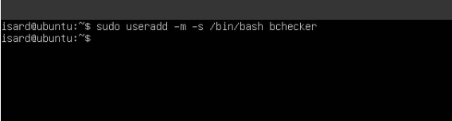

*Figura 1. Creación de la cuenta en la VM.*

Después se consultó su registro y se le puso contraseña con `sudo passwd bchecker`:

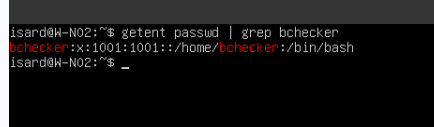

*Figura 2. La cuenta tiene `/home/bchecker` y `/bin/bash`.*

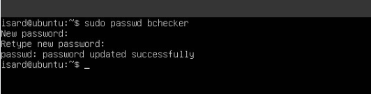

*Figura 3. El sistema confirma que la contraseña se actualizó.*

Las credenciales de laboratorio están en el README. La cuenta local de Linux y la cuenta de MySQL son independientes, aunque tengan el mismo nombre y contraseña.

## 3. Red y conectividad

La red se configura en `/etc/netplan/00-installer-config.yaml`, con dirección fija, ruta por defecto y DNS. El archivo está en [netplan-web.yaml](../config/web/netplan-web.yaml).

```yaml
network:
  version: 2
  ethernets:
    enp1s0:
      dhcp4: false
      addresses: [192.168.10.10/24]
      routes:
        - to: default
          via: 192.168.10.1
      nameservers:
        addresses: [1.1.1.1]
```

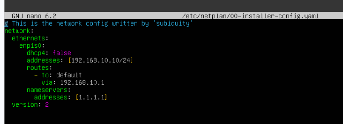

*Figura 4. Configuración de red de W-N02 (la misma captura que se usó al documentar el router).*

Se probó la conectividad con el gateway y con una dirección externa:

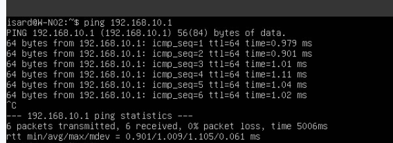

*Figura 5. Seis paquetes enviados y recibidos, con 0 % de pérdida, hacia el gateway.*

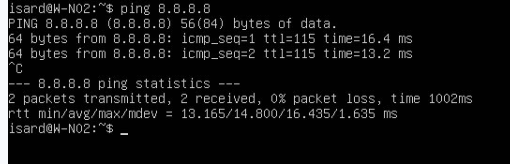

*Figura 6. Dos paquetes enviados y recibidos, con 0 % de pérdida, hacia una dirección externa.*

## 4. Instalación de Apache y PHP

Se ejecutó:

```bash
sudo apt install apache2 php php-mysql
```

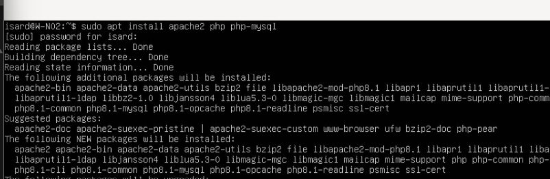

*Figura 7. Instalación del servidor web y de la extensión de PHP para MySQL.*

Apache atiende las peticiones HTTP, PHP ejecuta el código de la aplicación y `php-mysql` permite que PHP se conecte a MySQL. El servicio se comprobó con:

```bash
sudo systemctl status apache2
```

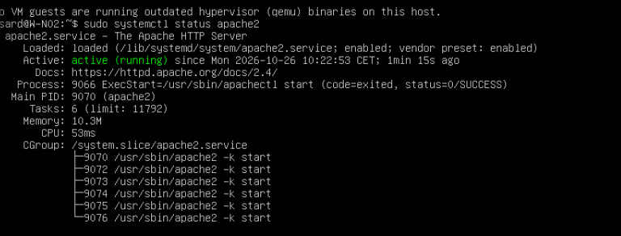

*Figura 8. Apache aparece como `active (running)` y la unidad como `enabled`.*

Referencia: [instalación de Apache en Ubuntu](https://ubuntu.com/server/docs/how-to/web-services/install-apache2/).

## 5. Despliegue de la aplicación

### 5.1. Sustitución de la página predeterminada

Primero se borró la página inicial de Apache:

```bash
sudo rm /var/www/html/index.html
```

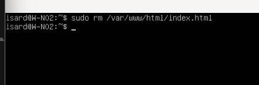

*Figura 9. Borrado de la página por defecto al preparar el directorio web.*

Después se editó `/var/www/html/index.php`.

### 5.2. Código y conexión con MySQL

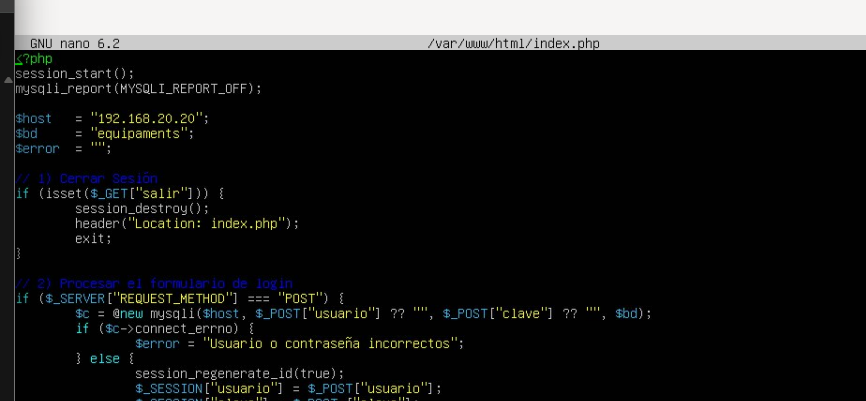

*Figura 10. Inicio del código PHP.*

En el código se ve lo siguiente:

- La sesión se inicia con `session_start()`.
- El servidor es `$host = "192.168.20.20"` y la base de datos `$bd = "equipaments"`.
- La acción de salir destruye la sesión y redirige a `index.php`.
- El formulario se procesa con una petición `POST`.
- Se intenta conectar con `mysqli` usando los campos `usuario` y `clave` del formulario.
- Si `connect_errno` indica un fallo, se muestra un mensaje de credenciales incorrectas.

El login usa las credenciales del formulario para conectarse directamente a MySQL, así que no hay una tabla de usuarios aparte en la aplicación. El inicio del código está en [index.php.fragmento.txt](../config/web/evidencias/index.php.fragmento.txt).

Referencias: [sesiones en PHP](https://www.php.net/manual/es/book.session.php) y [conexión mysqli](https://www.php.net/manual/es/mysqli.construct.php).

## 6. Prueba en navegador

### 6.1. Formulario de acceso

Desde un cliente se accede a `http://192.168.10.10`. La barra del navegador muestra `192.168.10.10/index.php` y se carga el formulario:

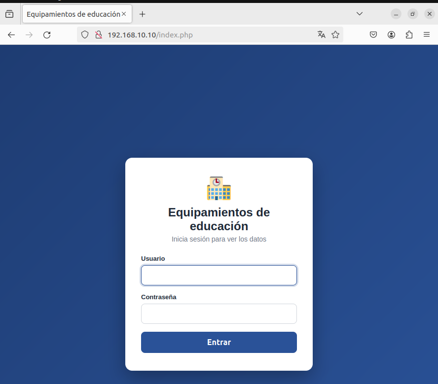

*Figura 11. Página Equipamientos de educación con los campos de usuario y contraseña.*

### 6.2. Tabla después del login

Se introdujeron las credenciales de laboratorio de `bchecker` y apareció el listado:

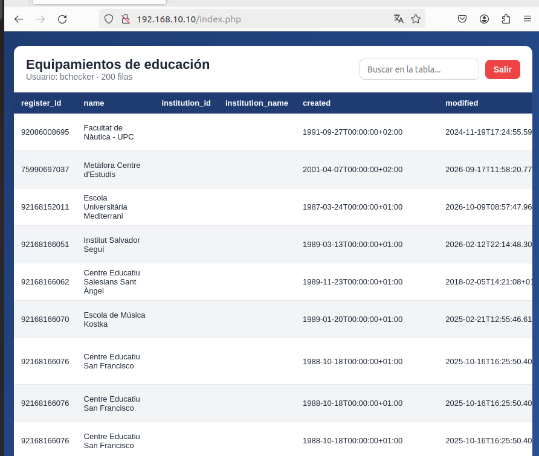

*Figura 12. Cabecera `Usuario: bchecker · 200 filas`, registros, buscador y botón Salir.*

Con esto la aplicación funciona de extremo a extremo: el formulario se conecta a MySQL y muestra los datos de la base `equipaments`.
