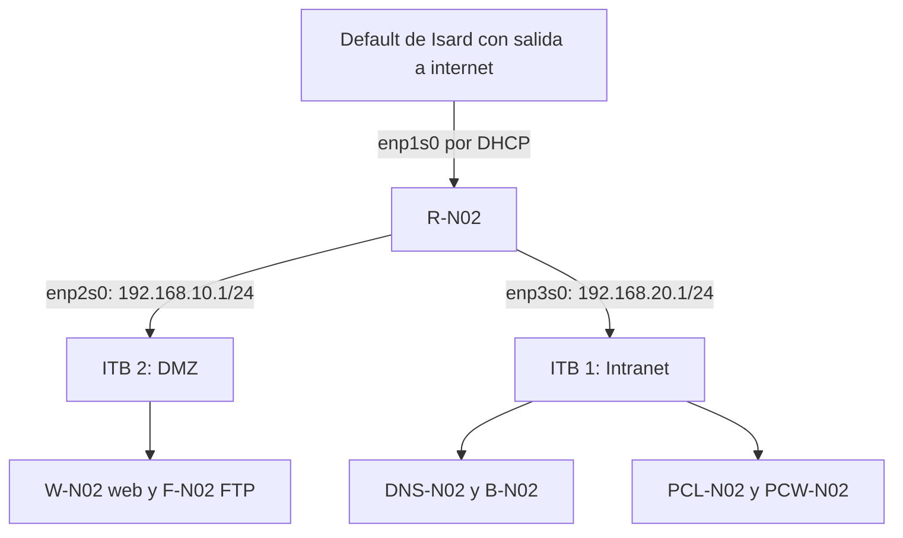

# Arquitectura de la infraestructura

[Volver al proyecto](../README.md) · [Inventario de configuración](<Ficheros de configuración.md>)

## 1. Diseño y alcance

El proyecto despliega una infraestructura virtual en Isard con tres segmentos: una red exterior de salida, una DMZ para servicios y una Intranet para clientes y servicios internos. R-N02 comunica esos segmentos. La aplicación web se aloja en W-N02 y apunta a una base de datos situada en B-N02.

**Estado: diseño documentado y validación funcional parcial.** El esquema siguiente se reconstruye a partir del README, la documentación existente y `Explicación i Capturas(2).docx`. No es una captura de un diagrama original de Isard ni acredita por sí mismo que todas las tarjetas y reglas estén configuradas así.

## 2. Segmentos de red

| Segmento | Red de Isard | Direccionamiento | Función |
| --- | --- | --- | --- |
| Exterior | Default | DHCP del entorno | Proporcionar salida al router. |
| DMZ | ITB 2 | `192.168.10.0/24` | Alojar el servidor web y el FTP. |
| Intranet | ITB 1 | `192.168.20.0/24` | Alojar DNS y DHCP, base de datos y clientes. |

La asignación de interfaces del router es la descrita en su [memoria](router.md). El diseño final prevé una sola conexión interna para cada VM que no sea el router. El Word también describe una conexión Default temporal durante la preparación de la base de datos; falta una captura que confirme su retirada en la configuración final.

La separación en segmentos define el direccionamiento. Para afirmar que existe aislamiento entre DMZ e Intranet hacen falta las reglas efectivas de filtrado y pruebas de accesos permitidos y bloqueados.

## 3. Inventario de equipos

| Equipo previsto | Servicio o función | Segmento | IPv4 | Puerta de enlace |
| --- | --- | --- | --- | --- |
| R-N02 | Router y NAT | Exterior, DMZ e Intranet | DHCP; `192.168.10.1`; `192.168.20.1` | Recibida por DHCP en el enlace exterior. |
| W-N02 | Apache, PHP y aplicación; SSH previsto | DMZ | `192.168.10.10/24` | `192.168.10.1` |
| F-N02 | vsftpd | DMZ | `192.168.10.11/24` | `192.168.10.1` |
| DNS-N02 | DNS y DHCP con dnsmasq | Intranet | `192.168.20.10/24` | `192.168.20.1` |
| B-N02 | Base de datos MySQL prevista | Intranet | `192.168.20.20/24`, según el esquema y el destino de la aplicación. | `192.168.20.1`, según el diseño. |
| PCL-N02 | Cliente Linux | Intranet | DHCP; observada `192.168.20.112/24` | `192.168.20.1` |
| PCW-N02 | Cliente Windows | Intranet | DHCP; observada `192.168.20.148/24` | `192.168.20.1` |

Las capturas del servidor de base de datos muestran el nombre **B-NCC**, no B-N02. El nombre definitivo y la dirección realmente aplicada deben contrastarse con esa VM. Las direcciones de clientes son concesiones temporales, no reservas acreditadas.

## 4. Relaciones entre servicios

| Origen | Destino | Servicio | Recorrido lógico previsto |
| --- | --- | --- | --- |
| Clientes de la Intranet | DNS-N02 | DHCP | Dentro de ITB 1; no requiere un relay entre estas máquinas. |
| Clientes de la Intranet | DNS-N02 | DNS | Consulta local al servidor `192.168.20.10`. |
| Cliente de la Intranet | W-N02 | HTTP | Intranet → R-N02 → DMZ. |
| PCL-N02 | F-N02 | FTP | Intranet → R-N02 → DMZ. |
| W-N02 | B-N02 | Conexión MySQL mediante PHP | DMZ → R-N02 → Intranet. |
| Equipos internos | Red exterior | Tráfico de salida | Gateway de su segmento → R-N02 → Default; NAT al salir por `enp1s0`. |

La captura del código PHP utiliza `192.168.20.20` como destino y `equipaments` como base de datos. La página muestra una tabla después del login. Es evidencia coherente con el flujo web a base de datos, pero faltan el código completo, la configuración de escucha y los permisos MySQL para reproducirlo de extremo a extremo.

## 5. Administración y preparación

El proyecto utiliza el usuario de revisión `bchecker`, con las credenciales de laboratorio descritas en el README. Las capturas permiten comprobar su creación en varios servidores y en Windows; la comprobación específica de la cuenta en el cliente Linux sigue pendiente.

El Word describe el uso del bastión de Isard y claves SSH para preparar la VM de base de datos. Esa vía de administración no se representa como una cuarta red de aplicación. Tampoco equivale a una prueba de SSH contra W-N02 ni a una conexión SSH del servidor web con GitHub.

El procedimiento de red se amplía en [Router](router.md), [DNS y DHCP](<DNS y DHCP.md>), [Clientes](Clientes.md), [FTP](<Servidor FTP.md>) y [Web y aplicación](<Servidor web, SSH y aplicación de prueba.md>).

## 6. Evidencias y validación pendiente

| Componente o relación | Evidencia disponible | Pendiente para cerrar la validación |
| --- | --- | --- |
| Router | Reenvío IPv4 aplicado, comando NAT y guardado de reglas. | Interfaces efectivas, reglas completas y prueba tras reinicio. |
| DHCP de clientes | IP dinámica y rutas Linux; `ipconfig /all` de Windows. | Nueva comprobación tras renovar las concesiones, si se requiere reproducibilidad. |
| DNS | Consulta a DNS-N02 con respuesta de R-N02. | Contrastar el alias con dnsmasq y consultar desde Windows. |
| FTP | Servicio activo e inicio de sesión desde PCL-N02. | Listado, subida, descarga y prueba desde Windows. |
| Web | Apache activo, formulario y tabla tras login. | Identificar el cliente de prueba y repetir en Linux y Windows. |
| Base de datos | Historial de preparación e importación intentada; destino visible en PHP. | Hostname final, IP efectiva, servicio, esquema, usuarios, permisos y carga reproducible. |
| SSH en W-N02 | Función prevista en el proyecto. | Instalación, configuración efectiva y sesión remota acreditada. |
| Filtrado entre redes | No hay exportación completa. | Definir y comprobar la política de acceso. |

Las capturas del [tablero ProofHub](<Planificacion con ProofHub.md>) muestran un diagrama de arquitectura pendiente de revisión en una de las vistas. Esa posición en el tablero no acredita una aceptación final. Esta memoria permite describir el diseño actual y delimitar qué queda por verificar.
