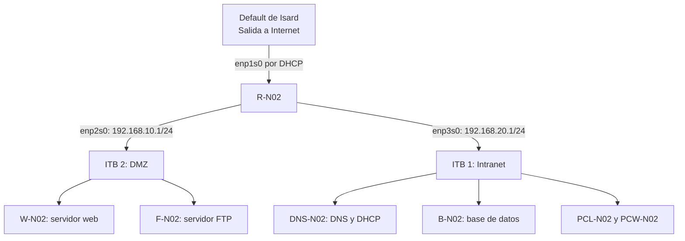

# Arquitectura de la infraestructura

[Volver al proyecto](../README.md) · [Inventario de configuración](<Ficheros de configuración.md>)

## 1. Diseño de la infraestructura

En este proyecto he montado una infraestructura de red en Isard con tres partes: la red exterior, la DMZ y la Intranet. Cada una tiene una función diferente y el router R-N02 se encarga de comunicar las redes.

En la DMZ están el servidor web W-N02 y el servidor FTP F-N02. En la Intranet están el servidor DNS y DHCP DNS-N02, el servidor de base de datos B-N02 y los dos equipos cliente, uno con Linux y otro con Windows.

**Estado del proyecto:** la infraestructura está documentada y algunas pruebas ya funcionan, aunque todavía quedan comprobaciones por hacer.

El siguiente esquema representa cómo está organizada la red según la documentación y las capturas de la práctica.

## 2. Redes utilizadas

| Segmento | Red de Isard | Dirección de red | Función |
|---|---|---|---|
| Exterior | Default | DHCP | Dar salida a Internet al router. |
| DMZ | ITB 2 | `192.168.10.0/24` | Servidor web y servidor FTP. |
| Intranet | ITB 1 | `192.168.20.0/24` | DNS, DHCP, base de datos y clientes. |

El router tiene tres interfaces: una para la red exterior, otra para la DMZ y otra para la Intranet. Las direcciones y los nombres de las interfaces están explicados con más detalle en la [documentación del router](router.md).

La idea es que las máquinas virtuales que no son el router tengan una sola conexión a su red correspondiente. En la documentación también aparece una conexión temporal a Default durante la preparación de la base de datos. Me falta comprobar que esa conexión se haya quitado en la configuración final.

Aunque las redes estén separadas, todavía tengo que revisar las reglas del firewall y comprobar qué conexiones se permiten entre la DMZ y la Intranet.

## 3. Equipos de la infraestructura

Esta es la lista de máquinas que forman parte del proyecto y las direcciones IP que aparecen en la documentación.

| Equipo | Función | Red | Dirección IP | Puerta de enlace |
|---|---|---|---|---|
| R-N02 | Router y NAT | Exterior, DMZ e Intranet | DHCP en el exterior; `192.168.10.1` y `192.168.20.1` en las redes internas | Recibida por DHCP en el exterior. |
| W-N02 | Apache, PHP y aplicación web | DMZ | `192.168.10.10/24` | `192.168.10.1` |
| F-N02 | Servidor FTP con vsftpd | DMZ | `192.168.10.11/24` | `192.168.10.1` |
| DNS-N02 | Servidor DNS y DHCP con dnsmasq | Intranet | `192.168.20.10/24` | `192.168.20.1` |
| B-N02 | Servidor de base de datos MySQL | Intranet | `192.168.20.20/24`, según el esquema del proyecto | `192.168.20.1`, según el diseño |
| PCL-N02 | Cliente Linux | Intranet | `192.168.20.112/24`, recibida por DHCP | `192.168.20.1` |
| PCW-N02 | Cliente Windows | Intranet | `192.168.20.148/24`, recibida por DHCP | `192.168.20.1` |

Las IP de los clientes son las que aparecen en las capturas y pueden cambiar porque se asignan mediante DHCP.

Hay un detalle que tengo que revisar: en las capturas del servidor de base de datos aparece el nombre **B-NCC** en vez de B-N02. Tengo que comprobar el nombre real de esa máquina y su dirección IP antes de dar por terminado el inventario.

## 4. Comunicación entre los equipos

En esta tabla se resumen las conexiones que necesita la infraestructura para funcionar.

| Origen | Destino | Servicio | Cómo se comunica |
|---|---|---|---|
| Clientes | DNS-N02 | DHCP | Los clientes reciben la configuración de red desde la Intranet. |
| Clientes | DNS-N02 | DNS | Consultan los nombres de los equipos al servidor `192.168.20.10`. |
| Clientes | W-N02 | HTTP | La conexión pasa desde la Intranet por R-N02 hasta la DMZ. |
| PCL-N02 | F-N02 | FTP | El cliente Linux accede al servidor FTP a través de R-N02. |
| W-N02 | B-N02 | MySQL | La aplicación PHP se conecta a la base de datos de la Intranet. |
| Equipos internos | Red exterior | Salida a Internet | El tráfico pasa por R-N02, que utiliza NAT para salir por la interfaz exterior. |

En las capturas del código PHP aparece la dirección `192.168.20.20` como destino de la base de datos y el nombre `equipaments`. También se ve la tabla de datos después de iniciar sesión en la aplicación.

Esto indica que la aplicación está preparada para consultar la base de datos. Para comprobar que todo funciona correctamente, todavía tengo que revisar la configuración completa de MySQL, los permisos del usuario y que la conexión se pueda repetir sin errores.

## 5. Administración de los servidores

Durante la práctica he utilizado el usuario `bchecker` para realizar algunas comprobaciones. En las capturas se ve su creación en varios equipos y en Windows, aunque todavía me falta comprobar si también está creado en el cliente Linux.

Para preparar la máquina de la base de datos, la documentación explica que se utilizó el bastión de Isard y las claves SSH. Este acceso se utilizó para administrar la máquina durante la preparación.

También queda pendiente comprobar el acceso SSH al servidor web W-N02, ya que es uno de los servicios previstos en el proyecto.

Para ver cómo he configurado cada parte, se pueden consultar estos apartados:

- [Router](router.md)
- [DNS y DHCP](<DNS y DHCP.md>)
- [Clientes](Clientes.md)
- [Servidor FTP](<Servidor FTP.md>)
- [Servidor web, SSH y aplicación de prueba](<Servidor web, SSH y aplicación de prueba.md>)

## 6. Pruebas realizadas y comprobaciones pendientes

Estas son las pruebas que aparecen en la documentación y lo que me falta revisar para terminar la práctica.

| Componente | Lo que he comprobado | Lo que falta |
|---|---|---|
| Router | Se ha configurado el reenvío IPv4 y NAT, y se han guardado las reglas. | Revisar las interfaces y comprobar que las reglas siguen funcionando después de reiniciar. |
| DHCP | Linux recibe una IP dinámica y Windows muestra su configuración con `ipconfig /all`. | Comprobar de nuevo las concesiones si es necesario. |
| DNS | La consulta desde Linux devuelve la IP de R-N02. | Revisar el nombre configurado en dnsmasq y probar desde Windows. |
| FTP | El servicio está activo y el inicio de sesión desde Linux funciona. | Probar el listado de archivos, la subida, la descarga y el acceso desde Windows. |
| Servidor web | Apache está activo y se ha mostrado el formulario y la tabla de la aplicación. | Repetir la prueba desde los dos clientes y guardar las capturas. |
| Base de datos | Hay documentación de la preparación y el código PHP muestra la dirección de destino. | Comprobar el nombre de la máquina, la IP, MySQL, las tablas y los permisos. |
| SSH en W-N02 | El acceso está previsto en el proyecto. | Comprobar la configuración y realizar una conexión remota. |
| Firewall | La infraestructura tiene las redes separadas. | Revisar las reglas y comprobar qué conexiones se permiten y cuáles se bloquean. |

En el tablero de [ProofHub](<Planificacion con ProofHub.md>) también hay un diagrama de la arquitectura que aparece pendiente de revisión. Por eso, todavía tengo que comprobar que coincide con la configuración final.

Con estas comprobaciones podré terminar de validar la infraestructura y asegurarme de que los equipos se comunican correctamente según el diseño del proyecto.

