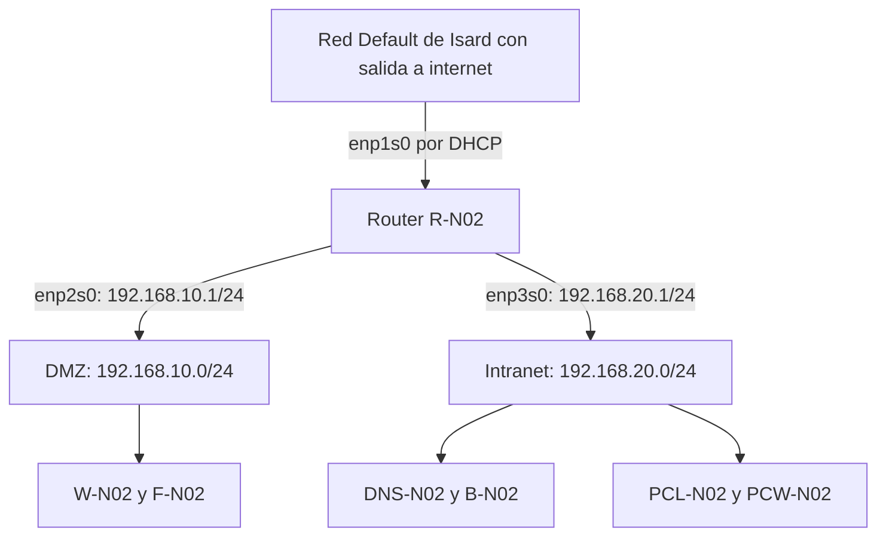

# Router R-N02

[Volver al proyecto](../README.md) · [Archivos de configuración](../config/router/README.md)

## 1. Objetivo y alcance

El router **R-N02** conecta las redes DMZ e Intranet del proyecto con la red Default de Isard, que es la que nos da salida a internet. Los equipos de cada red usan como puerta de enlace la IP que tiene el router en su red.

Lo he montado con **Ubuntu Server 24.04** y esta parte la he hecho yo (**Elian**). En esta memoria explico cómo le puse el nombre al equipo, cómo configuré las IPs, cómo activé que el router pase paquetes de una red a otra y cómo configuré la salida a internet. También incluyo las pruebas que hice.

## 2. Topología y direccionamiento

### 2.1. Interfaces del router

| Interfaz | Red de Isard | Segmento | Dirección IPv4 | Función |
| --- | --- | --- | --- | --- |
| `enp1s0` | Default | Salida exterior | Asignada por DHCP | Conectar con la red de salida de Isard. |
| `enp2s0` | ITB 2 | DMZ `192.168.10.0/24` | `192.168.10.1/24` | Puerta de enlace de los servidores de la DMZ. |
| `enp3s0` | ITB 1 | Intranet `192.168.20.0/24` | `192.168.20.1/24` | Puerta de enlace de los equipos de la Intranet. |



El esquema muestra cómo se conectan las redes. Todo el tráfico de salida de las dos redes internas pasa por R-N02 y después por la red Default de Isard.

### 2.2. Puertas de enlace de los equipos

| Segmento | Equipos del proyecto | Puerta de enlace |
| --- | --- | --- |
| DMZ | Web y SSH `W-N02` (`192.168.10.10`) y FTP `F-N02` (`192.168.10.11`). | `192.168.10.1` |
| Intranet | DNS y DHCP `DNS-N02` (`192.168.20.10`), base de datos `B-N02` (`192.168.20.20`) y clientes Linux y Windows. | `192.168.20.1` |

Las VMs llevan una sola tarjeta de red: **ITB 2 para la DMZ** o **ITB 1 para la Intranet**. La red Default solo la usa el router para salir. Así los equipos internos no pueden salir por otro sitio y se puede comprobar que todo el tráfico pasa por R-N02.

## 3. Configuración del router

### 3.1. Usuario de revisión y nombre del equipo

Primero creé el usuario `bchecker`, que hace falta en todos los sistemas del proyecto:

```bash
sudo adduser bchecker
```

La contraseña de laboratorio es la que pone en el [README del proyecto](../README.md).


*Figura 1. Creación del usuario de revisión. El equipo todavía muestra su nombre inicial en el prompt.*

Después le puse el nombre al router y lo comprobé:

```bash
sudo hostnamectl set-hostname R-N02
hostname
```


*Figura 2. Nombre del router después del cambio.*

### 3.2. Direccionamiento con Netplan

Las IPs las configuré en el fichero `/etc/netplan/50-cloud-init.yaml`, que quedó así:

```yaml
network:
  version: 2
  ethernets:
    enp1s0:
      dhcp4: true
    enp2s0:
      addresses: [192.168.10.1/24]
    enp3s0:
      addresses: [192.168.20.1/24]
```

Hay una copia del fichero en [netplan-router.yaml](../config/router/netplan-router.yaml).

`enp1s0` coge la IP por DHCP, y con ella también la ruta para salir a internet. Las otras dos interfaces llevan IP fija para que las puertas de enlace de las redes internas no cambien. No hizo falta añadir rutas hacia la DMZ ni la Intranet porque el router está conectado directamente a las dos.

Antes de tocar nada miré qué interfaces tenía y qué ficheros había ya en Netplan:

```bash
ip -br address
ip route
ls -l /etc/netplan/
```

Para aplicar los cambios usé:

```bash
sudo netplan apply
```

Referencia: [documentación de Netplan](https://netplan.readthedocs.io/en/stable/netplan-yaml/).

### 3.3. Reenvío de paquetes IPv4

Para que el equipo pase paquetes de una interfaz a otra, como hace un router, activé esta línea en `/etc/sysctl.conf`:

```ini
net.ipv4.ip_forward=1
```

Con valor `1` Linux deja de descartar los paquetes que no son para él y los reenvía. Hay una copia de la línea en [sysctl-router.conf](../config/router/sysctl-router.conf).


*Figura 3. Activación de `net.ipv4.ip_forward=1` en `/etc/sysctl.conf`.*

Para cargar los cambios ejecuté:

```bash
sudo sysctl -p
```

Y el sistema devolvió el valor aplicado:

```text
net.ipv4.ip_forward = 1
```


*Figura 4. El sistema devuelve el valor `1` después de cargar la configuración.*

Se puede volver a comprobar en cualquier momento con `sysctl net.ipv4.ip_forward`.

Referencia: [parámetro ip_forward del kernel Linux](https://docs.kernel.org/networking/ip-sysctl.html).

### 3.4. NAT para la salida a internet

Para que las redes internas puedan salir a internet añadí esta regla:

```bash
sudo iptables -t nat -A POSTROUTING -o enp1s0 -j MASQUERADE
```

| Elemento | Significado |
| --- | --- |
| `-t nat` | Usa la tabla de NAT. |
| `-A POSTROUTING` | Añade la regla para los paquetes que ya están a punto de salir del router. |
| `-o enp1s0` | Se aplica a los paquetes que salen por la interfaz exterior. |
| `-j MASQUERADE` | Cambia la IP de origen por la que tiene el router en la interfaz de salida. |

Las redes internas usan IPs privadas, que no se pueden usar directamente en internet. Con el enmascaramiento, las conexiones salen con la IP que tiene R-N02 en la red Default y las respuestas vuelven al equipo que las pidió. Uso `MASQUERADE` porque la IP de `enp1s0` la da el DHCP y puede cambiar.


*Figura 5. Ejecución de la regla de enmascaramiento con salida por `enp1s0`.*

El comando está guardado en [iptables-nat.txt](../config/router/iptables-nat.txt). Antes de volver a ejecutarlo se puede mirar si la regla ya existe para no duplicarla:

```bash
sudo iptables -t nat -C POSTROUTING -o enp1s0 -j MASQUERADE
```

Si no da ningún error es que la regla ya está puesta.

Referencia: [manual de iptables y objetivo MASQUERADE en Ubuntu 24.04](https://manpages.ubuntu.com/manpages/noble/man8/iptables-extensions.8.html).

### 3.5. Guardar las reglas

Las reglas de `iptables` se pierden al reiniciar si no se guardan, así que instalé `iptables-persistent`. Durante la instalación pregunta si se quieren guardar las reglas actuales y respondí que sí. Las guarda en el fichero `/etc/iptables/rules.v4`.

```bash
sudo apt update
sudo apt install iptables-persistent
sudo netfilter-persistent save
```

El último comando sirve para volver a guardar las reglas si hago cambios más adelante.


*Figura 6. Aceptación del guardado durante la instalación. También pregunta por las reglas IPv6, pero en este proyecto solo trabajamos con IPv4.*

Referencia: [manual de netfilter-persistent](https://manpages.ubuntu.com/manpages/noble/man8/netfilter-persistent.8.html).

## 4. Pruebas hechas desde la DMZ

Para probar el router usé el servidor web. Estas capturas son de **W-N02**, no del propio router.

### 4.1. Configuración del equipo de origen

La captura del servidor web muestra la IP `192.168.10.10/24`, la puerta de enlace `192.168.10.1` y el DNS `1.1.1.1`.


*Figura 7. Direccionamiento y puerta de enlace de W-N02. La interfaz `enp1s0` de esta VM no es la misma que la `enp1s0` del router.*

### 4.2. Conectividad con la puerta de enlace

Desde W-N02 hice ping al router:

```bash
ping 192.168.10.1
```

Salieron **6 paquetes enviados, 6 recibidos y 0 % de pérdida**, así que el servidor web llega sin problemas a la interfaz del router en la DMZ.


*Figura 8. Respuesta de la puerta de enlace `192.168.10.1`.*

### 4.3. Conectividad con una dirección externa

Después probé con una dirección de fuera:

```bash
ping 8.8.8.8
```

Salieron **2 paquetes enviados, 2 recibidos y 0 % de pérdida**. Esto demuestra que W-N02 tiene salida a internet a través del router, con el reenvío y el NAT que configuré antes.


*Figura 9. Respuesta de `8.8.8.8` desde la DMZ.*

El ping lo hice a una IP y no a un nombre como Google, así que esta prueba solo comprueba la conectividad, no el DNS.

## 5. Comprobaciones

Estos son los comandos que uso para revisar que el router está bien configurado:

| Origen | Comprobación | Qué tiene que salir |
| --- | --- | --- |
| R-N02 | `ip -br address` | Las tres interfaces con las IPs de la tabla. |
| R-N02 | `ip route` | Las rutas de las dos redes internas y la ruta por defecto por `enp1s0`. |
| R-N02 | `sysctl net.ipv4.ip_forward` | Valor `1`. |
| R-N02 | `sudo iptables -t nat -S POSTROUTING` | La regla `MASQUERADE`. |
| R-N02 | `sudo cat /etc/iptables/rules.v4` | La regla NAT guardada. |
| R-N02 | `systemctl is-enabled netfilter-persistent` | Que el servicio esté activado al arrancar. |
| Equipo de la Intranet | `ping -c 4 192.168.20.1` | Respuesta de la puerta de enlace de su red. |
| Equipo de la Intranet | `ping -c 4 8.8.8.8` | Salida a internet desde la Intranet. |
| W-N02 e Intranet | `ip -br address` e `ip route` | Una sola IP interna y la ruta por defecto por el router. |

## 6. Problemas habituales

| Problema | Qué revisar |
| --- | --- |
| Un equipo no llega a su puerta de enlace. | Su red en Isard, la IP, la máscara y que la interfaz esté activa. También la interfaz del router en esa red. |
| El router tiene internet, pero un equipo interno no. | La puerta de enlace del equipo, el `ip_forward` y la regla NAT. |
| Funciona la DMZ, pero no la Intranet. | La conexión ITB 1, la IP `192.168.20.1/24` y la puerta de enlace de los equipos de la Intranet. |
| Se llega a una IP de fuera, pero no se resuelven nombres. | El DNS del equipo y el servicio en [DNS y DHCP](<DNS y DHCP.md>). |
| Después de reiniciar deja de haber internet. | La configuración de Netplan, el valor de `ip_forward` y el fichero `rules.v4`. |
