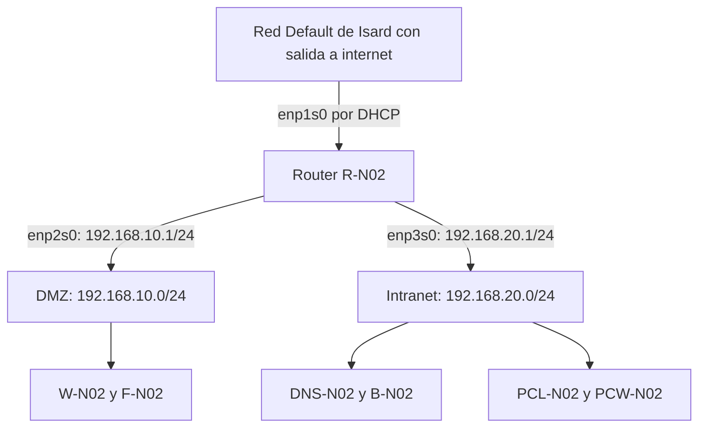
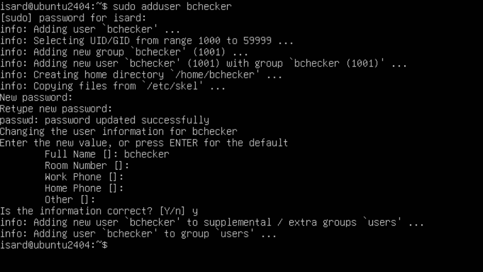
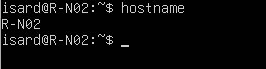
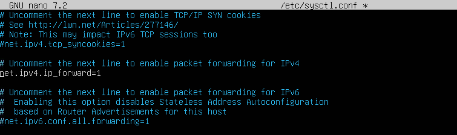
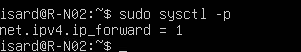
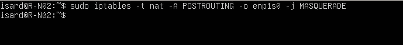
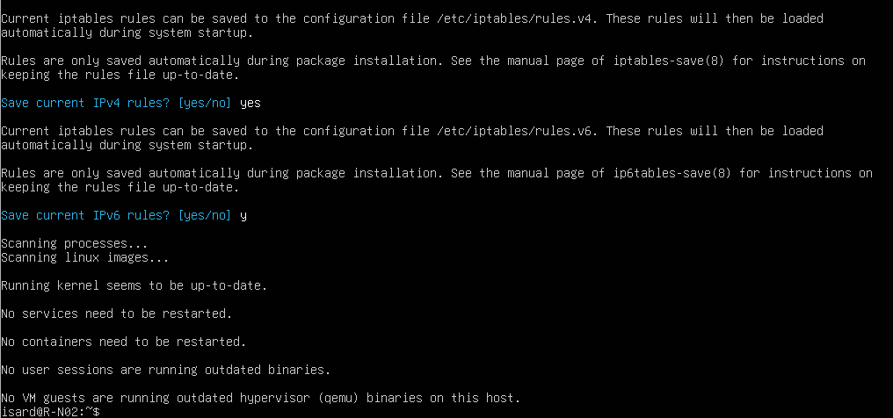

# Router R-N02

[Volver al proyecto](../README.md) · [Archivos de configuración](../config/router/README.md)

## 1. Objetivo y alcance

El router **R-N02** conecta las redes DMZ e Intranet del proyecto con la red Default de Isard, que es la que nos da salida a internet. Los equipos de cada red usan como puerta de enlace la IP que tiene el router en su red.

Lo he montado con **Ubuntu Server 24.04** y esta parte la he hecho yo (**Elian**). En esta memoria explico cómo le puse el nombre al equipo, cómo configuré las IPs, cómo activé que el router pase paquetes de una red a otra y cómo configuré la salida a internet. También incluyo las pruebas que hice.

## 2. Topología y direccionamiento

### 2.1. Interfaces del router

| Interfaz | Red de Isard | Segmento | Dirección IPv4 | Función |
| --- | --- | --- | --- | --- |
| `enp1s0` | Default | Salida exterior | Asignada por DHCP | Conectar con la red de salida de Isard. |
| `enp2s0` | ITB 2 | DMZ `192.168.10.0/24` | `192.168.10.1/24` | Puerta de enlace de los servidores de la DMZ. |
| `enp3s0` | ITB 1 | Intranet `192.168.20.0/24` | `192.168.20.1/24` | Puerta de enlace de los equipos de la Intranet. |

La asociación de interfaces procede de la versión anterior de `docs/router.md`. La captura de la regla NAT confirma el uso de `enp1s0` como interfaz de salida; falta una captura de las tres interfaces para contrastar el resto de la tabla con la VM.



El esquema representa las conexiones lógicas entre los segmentos. El tráfico de salida de las dos redes internas atraviesa R-N02 y, después, la red Default de Isard.

### 2.2. Puertas de enlace de los equipos

| Segmento | Equipos del proyecto | Puerta de enlace |
| --- | --- | --- |
| DMZ | Web y SSH `W-N02` (`192.168.10.10`) y FTP `F-N02` (`192.168.10.11`). | `192.168.10.1` |
| Intranet | DNS y DHCP `DNS-N02` (`192.168.20.10`), base de datos `B-N02` (`192.168.20.20`) y clientes Linux y Windows. | `192.168.20.1` |

En la configuración final descrita por el equipo, estas VMs llevan una sola tarjeta: **ITB 2 para la DMZ** o **ITB 1 para la Intranet**. Default queda como enlace exterior del router. Esto evita que los equipos internos utilicen una salida alternativa que impida comprobar el paso del tráfico por R-N02.

## 3. Configuración del router

### 3.1. Usuario de revisión y nombre del equipo

Se creó el usuario `bchecker`, requerido en los sistemas del proyecto, mediante:

```bash
sudo adduser bchecker
```

La contraseña de laboratorio es la indicada en el [README del proyecto](../README.md). La captura muestra la creación de la cuenta, su directorio personal y la asignación de contraseña, pero no acredita permisos administrativos adicionales.



*Figura 1. Creación del usuario de revisión. El equipo todavía muestra su nombre inicial en el prompt.*

Para reproducir la asignación del nombre del router y comprobarlo:

```bash
sudo hostnamectl set-hostname R-N02
hostname
```

La evidencia disponible muestra la comprobación con `hostname` y el resultado `R-N02`.



*Figura 2. Nombre del router después del cambio.*

### 3.2. Direccionamiento con Netplan

La documentación previa sitúa la configuración en `/etc/netplan/50-cloud-init.yaml` y recoge este contenido:

```yaml
network:
  version: 2
  ethernets:
    enp1s0:
      dhcp4: true
    enp2s0:
      addresses: [192.168.10.1/24]
    enp3s0:
      addresses: [192.168.20.1/24]
```

Se conserva una copia en [netplan-router.yaml](../config/router/netplan-router.yaml). **Procede del texto anterior del repositorio; el Word no contiene una captura del Netplan del router.** Su contenido y el nombre del fichero efectivo deben contrastarse con la VM.

`dhcp4: true` permite obtener la dirección y, normalmente, la ruta predeterminada del enlace exterior. Las direcciones estáticas mantienen estables las puertas de enlace internas. No se añaden rutas predeterminadas hacia la DMZ o la Intranet: son redes directamente conectadas.

Antes de cambiar la red, identificar las interfaces y revisar los archivos existentes:

```bash
ip -br address
ip route
ls -l /etc/netplan/
```

Integrar los ajustes en la configuración existente, evitando definiciones contradictorias en varios YAML. Para validar y probar los cambios:

```bash
sudo netplan generate
sudo netplan try
```

`netplan try` aplica temporalmente la configuración y solicita confirmación; si no se confirma dentro del plazo, intenta revertirla. Hay que comprobar el estado de la red si la prueba se cancela o vence. La versión anterior de la memoria indicaba que se utilizó `sudo netplan apply`. Estos comandos de revisión no tienen una captura de ejecución adicional.

Referencia: [documentación de Netplan](https://netplan.readthedocs.io/en/stable/netplan-yaml/) y [netplan try](https://netplan.readthedocs.io/en/stable/netplan-try/).

### 3.3. Reenvío de paquetes IPv4

Para que Linux reenvíe paquetes entre interfaces, se activó esta directiva en `/etc/sysctl.conf`:

```ini
net.ipv4.ip_forward=1
```

Con valor `1`, el kernel habilita el reenvío IPv4. Este ajuste permite el funcionamiento como router, sujeto a las rutas y a las reglas de filtrado que tenga el equipo. La directiva visible se conserva en [sysctl-router.conf](../config/router/sysctl-router.conf), como fragmento documental del archivo de sistema.



*Figura 3. Activación de `net.ipv4.ip_forward=1` en `/etc/sysctl.conf`.*

Los cambios se cargaron con:

```bash
sudo sysctl -p
```

La salida visible confirma el valor aplicado:

```text
net.ipv4.ip_forward = 1
```



*Figura 4. El sistema devuelve el valor `1` después de cargar la configuración.*

La comprobación posterior, sin modificar el valor, se puede realizar con `sysctl net.ipv4.ip_forward`.

Referencia: [parámetro ip_forward del kernel Linux](https://docs.kernel.org/networking/ip-sysctl.html).

### 3.4. Traducción de direcciones para la salida a internet

Se añadió la siguiente regla:

```bash
sudo iptables -t nat -A POSTROUTING -o enp1s0 -j MASQUERADE
```

| Elemento | Significado |
| --- | --- |
| `-t nat` | Selecciona la tabla de traducción de direcciones. |
| `-A POSTROUTING` | Añade la regla a la cadena que actúa después de decidir la ruta de salida. |
| `-o enp1s0` | Selecciona los paquetes que salen por la interfaz exterior. |
| `-j MASQUERADE` | Sustituye la dirección de origen por la dirección de la interfaz de salida. |

Las redes internas utilizan direcciones privadas. El enmascaramiento permite que sus conexiones salgan con la dirección que tiene R-N02 en Default. Isard proporciona el acceso posterior a internet; la dirección de `enp1s0` no tiene por qué ser pública. `MASQUERADE` se adapta a que esta dirección se asigne por DHCP.



*Figura 5. Ejecución de la regla de enmascaramiento con salida por `enp1s0`.*

El comando original está en [iptables-nat.txt](../config/router/iptables-nat.txt). Antes de repetirlo, comprobar si la regla existe para evitar duplicarla:

```bash
sudo iptables -t nat -C POSTROUTING -o enp1s0 -j MASQUERADE
```

Una salida con código `0` indica coincidencia. Si hay un error, hay que distinguir entre ausencia de la regla y otros problemas, como falta de permisos.

Referencia: [manual de iptables y objetivo MASQUERADE en Ubuntu 24.04](https://manpages.ubuntu.com/manpages/noble/man8/iptables-extensions.8.html).

### 3.5. Persistencia de las reglas

Las reglas cargadas con `iptables` necesitan guardarse para recuperarlas al arrancar. Se utilizó `iptables-persistent`; la captura muestra la aceptación del guardado de reglas y la referencia al fichero IPv4 `/etc/iptables/rules.v4`.

```bash
sudo apt update
sudo apt install iptables-persistent
sudo netfilter-persistent save
```

La instalación y el guardado interactivo están reflejados en el Word. El comando `netfilter-persistent save` figura en la documentación previa del repositorio y permite guardar cambios posteriores. Guarda el conjunto de reglas cargadas, por lo que conviene revisarlo antes.



*Figura 6. Aceptación del guardado durante la instalación. La pregunta sobre IPv6 no demuestra que se haya configurado enrutamiento IPv6.*

No se dispone de una exportación completa de `rules.v4` ni de una prueba tras reiniciar. Por ello, el repositorio conserva el comando NAT acreditado y no reconstruye un supuesto fichero completo de reglas.

Referencia: [manual de netfilter-persistent](https://manpages.ubuntu.com/manpages/noble/man8/netfilter-persistent.8.html).

## 4. Pruebas acreditadas desde la DMZ

El apartado del servidor web del Word aporta evidencias complementarias sobre el router. Estas capturas pertenecen a **W-N02**, no a la configuración interna de R-N02.

### 4.1. Configuración del equipo de origen

La captura del servidor web muestra `192.168.10.10/24`, una ruta predeterminada por `192.168.10.1` y el DNS `1.1.1.1`.


*Figura 7. Direccionamiento y puerta de enlace de W-N02. La interfaz `enp1s0` de esta VM es distinta de la interfaz homónima del router.*

### 4.2. Conectividad con la puerta de enlace

En W-N02 se ejecutó:

```bash
ping 192.168.10.1
```

La captura registra **6 paquetes enviados, 6 recibidos y 0 % de pérdida**. Acredita conectividad IP entre el servidor web y la interfaz del router situada en la DMZ.


*Figura 8. Respuesta de la puerta de enlace `192.168.10.1`.*

### 4.3. Conectividad con una dirección externa

También se ejecutó:

```bash
ping 8.8.8.8
```

La captura registra **2 paquetes enviados, 2 recibidos y 0 % de pérdida**. Demuestra conectividad con esa dirección externa desde W-N02 en el momento de la prueba. Es coherente con el reenvío y el NAT configurados; para atribuir todo el recorrido exclusivamente al router, queda por documentar que la VM no mantiene una interfaz Default adicional.


*Figura 9. Respuesta de `8.8.8.8` desde la DMZ.*

Aunque el texto original menciona una prueba con Google, la captura muestra una dirección IP. Por tanto, esta evidencia acredita conectividad IP, pero no una consulta DNS ni el acceso a una página web. El ping a `1.1.1.1` sugerido en el Word tampoco aparece como prueba ejecutada.

## 5. Comprobaciones para completar la validación

Las siguientes órdenes son una guía de revisión. Sus resultados no se han obtenido durante la preparación de esta documentación.

| Origen | Comprobación | Resultado que se debe verificar |
| --- | --- | --- |
| R-N02 | `ip -br address` | Tres interfaces con las direcciones y redes de la tabla. |
| R-N02 | `ip route` | Rutas hacia ambas redes internas y ruta predeterminada por `enp1s0`. |
| R-N02 | `sysctl net.ipv4.ip_forward` | Valor `1`. |
| R-N02 | `sudo iptables -t nat -S POSTROUTING` | Presencia de la regla `MASQUERADE` documentada. |
| R-N02 | `sudo iptables -L FORWARD -n -v` | Política y reglas que permitan el tráfico previsto entre interfaces. |
| R-N02 | `sudo cat /etc/iptables/rules.v4` | Presencia de la regla NAT en la configuración guardada. |
| R-N02 | `systemctl is-enabled netfilter-persistent` | Carga al arranque habilitada, según la configuración del servicio. |
| Equipo de la Intranet | `ping -c 4 192.168.20.1` | Respuesta de la puerta de enlace de su segmento. |
| Equipo de la Intranet | `ping -c 4 8.8.8.8` | Conectividad externa desde la segunda red interna. |
| W-N02 e Intranet | Revisar las tarjetas en Isard y ejecutar `ip -br address` e `ip route`. | Una única conexión interna y salida por la puerta de enlace de R-N02. |

En una ventana de mantenimiento, reiniciar R-N02 y repetir las comprobaciones de interfaces, rutas, reenvío, NAT y conectividad desde ambas redes. Esta prueba es la que permitiría acreditar la persistencia efectiva.

La regla de NAT y la activación de `ip_forward` no documentan una política de aislamiento entre la DMZ y la Intranet. Para describir esa política hacen falta las reglas de filtrado efectivas y pruebas de los accesos permitidos y bloqueados.

## 6. Diagnóstico de incidencias

| Síntoma | Revisión inicial |
| --- | --- |
| Un equipo no alcanza su puerta de enlace. | Revisar su red de Isard, dirección, máscara y estado de la interfaz; comprobar también la interfaz interna del router. |
| El router tiene salida, pero un equipo interno no. | Revisar la ruta predeterminada del equipo, `ip_forward`, la cadena `FORWARD` y la regla NAT. |
| Funciona la DMZ, pero no la Intranet. | Revisar la conexión ITB 1, `192.168.20.1/24` y la puerta de enlace de los equipos de esa red. |
| Se alcanza una IP externa, pero no se resuelven nombres. | Revisar el DNS del equipo y el servicio correspondiente en [DNS y DHCP](<DNS y DHCP.md>). |
| La salida deja de funcionar después de reiniciar. | Revisar la configuración persistente de Netplan, el valor de `ip_forward`, `rules.v4` y la carga de reglas al arranque. |

## 7. Estado de la documentación

Quedan acreditados mediante capturas la creación del usuario, el nombre del router, la activación del reenvío IPv4, la ejecución del comando NAT y el guardado interactivo de reglas. Las pruebas de W-N02 acreditan respuestas de la puerta de enlace de la DMZ y de una dirección externa.

Para cerrar la validación quedan estas evidencias:

- [ ] Captura de las tres tarjetas del router en Isard y sus direcciones en Ubuntu.
- [ ] Copia del Netplan efectivo y de la tabla de rutas de R-N02.
- [ ] Exportación de las reglas NAT y de filtrado realmente cargadas.
- [ ] Confirmación de que los equipos internos utilizan una sola tarjeta.
- [ ] Prueba de salida desde la Intranet.
- [ ] Pruebas de conectividad y persistencia después de reiniciar el router.

Los [archivos de configuración](../config/router/README.md) indican su procedencia y su alcance. Las nueve imágenes se han extraído del Word conservando sus bytes originales. Esta actualización documenta la práctica; no aplica cambios en las VMs.
